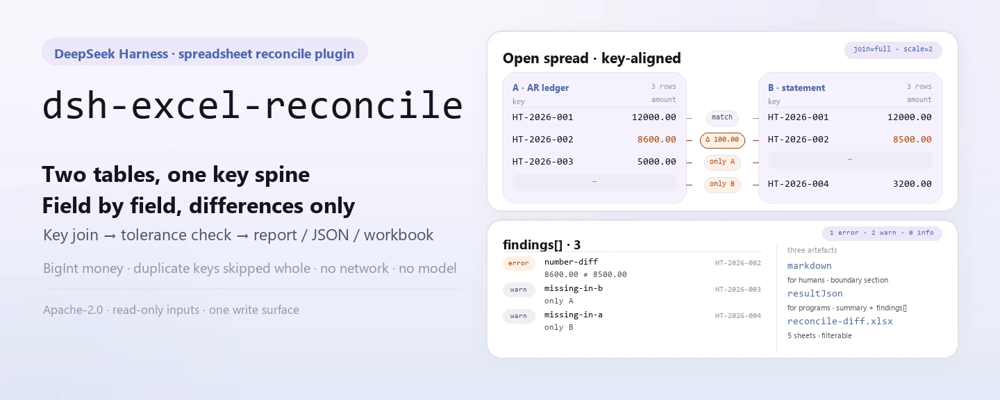
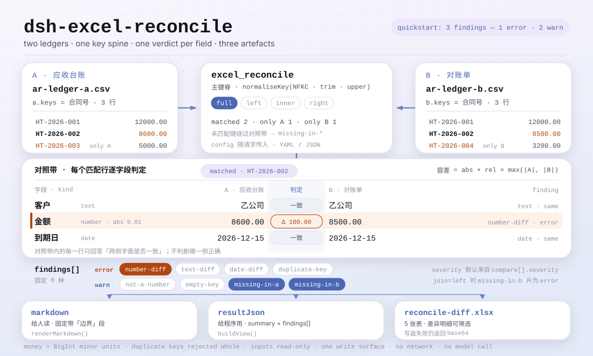

<div align="center">

<picture>
  <source media="(prefers-color-scheme: dark)" srcset="docs/assets/dsh-excel-reconcile-hero-en-dark.webp">
  
</picture>

# dsh-excel-reconcile

**Align two Excel/CSV tables on a key and get every field that disagrees — differences only, no verdict.**

A reconciliation plugin for DeepSeek Harness: join two tables on declared keys, compare declared fields with declared tolerances, and emit a Markdown report, a JSON result, and a diff workbook; money is compared as integer minor units and a duplicated key is skipped whole instead of paired arbitrarily.

[Install](#three-step-setup) · [Configuration](#configuration) · [FAQ](#faq) · [简体中文](README.md) · [English](README.en.md)

[](LICENSE)
[](#compatibility)
[](https://www.npmjs.com/package/dsh-excel-reconcile)
[](https://github.com/PerryLink/dsh-excel-reconcile/actions/workflows/ci.yml)
[](#compatibility)

[](https://github.com/PerryLink/dsh-excel-reconcile/stargazers)
[](https://www.npmjs.com/package/dsh-excel-reconcile)
[](https://dshfind.com/en/plugins/PerryLink/dsh-excel-reconcile?ref=badge)
[](https://securityscorecards.dev/viewer/?uri=github.com/PerryLink/dsh-excel-reconcile)

```sh
dsh plugin --profile <name> add dsh-excel-reconcile
```

</div>

<sub>Community plugin, not affiliated with DeepSeek. Canonical repository: <https://github.com/PerryLink/dsh-excel-reconcile>.</sub>

## What it is

`dsh-excel-reconcile` aligns two tables (`.xlsx` / `.xlsm` / `.csv` / `.docx` tables) on the configured keys, compares field by field, and emits three artifacts: a Markdown report for people, a JSON result for programs, and a diff workbook (five sheets) for the reviewer. Each call performs exactly one reconciliation: keys, compared fields, join mode, and tolerances travel with the request as YAML/JSON — no fixed rule pack ships with the package.

It reconciles; it does not adjudicate. A difference means the two sides disagree, not that either is wrong. Money is compared as integer minor units (BigInt), never floating point, so `12.3` and `12.30000000001` are the same amount at two decimal places; a key that appears twice is reported as `duplicate-key` and skipped whole rather than paired arbitrarily — pairing the first match hides the difference that matters. Pure ESM: no network requests, no model calls.

<picture>
  <source media="(prefers-color-scheme: dark)" srcset="docs/assets/dsh-excel-reconcile-flow-v5-dark.svg">
  
</picture>

## Three-step setup

1. **Install**:

   ```sh
   dsh plugin --profile <name> add dsh-excel-reconcile
   dsh --profile <name> --dump-config | grep 'dsh-excel-reconcile'
   ```

   The plugin registers as a bundle patch row (`cordis.patch.yml` only `insert`s its own row); the tool it exposes is named `excel_reconcile`.

2. **Minimal config** (profile patch; all three keys are optional):

   ```yaml
   - insert:
       - id: dsh-excel-reconcile
         name: dsh-excel-reconcile
         config:
           timeoutMs: 120000
           scale: 2
           diffWorkbook: reconcile-diff.xlsx
   ```

3. **Verify it mounts**: ask the model to call `excel_reconcile` in a session, or run the bundled sample from a checkout (run `pnpm install && pnpm run build` first — the sample loads `lib/index.mjs`):

   ```sh
   node samples/quickstart/run.mjs --check
   ```

   ```
   $ node samples/quickstart/run.mjs
   excel_reconcile: 3 finding(s) — 1 error, 2 warn, 0 info
   rows: A=3 B=3, matched 2, only A=1, only B=1, duplicate keys=0
   ```

   *Observed from `docs/assets/quickstart.log`; expected values in `samples/quickstart/expected/result.json`*

**Uninstall**: `dsh plugin --profile <name> remove dsh-excel-reconcile` (or remove the row from the profile patch).

## Core capabilities

- **Key-based alignment (four join modes)** — `join` is `full` (default, keep both sides), `left`, `inner`, or `right`; `a.keys` and `b.keys` match positionally, and a length mismatch fails loudly.
- **Field-by-field comparison with declared tolerances** — each `compare[]` entry declares `a` (and optional `b`), `kind` (`number`/`text`/`date`), `abs`/`rel`, `severity`, and `label`; the numeric allowance is `abs + rel × max(|A|, |B|)`.
- **Typed differences** — `number-diff`, `text-diff`, `date-diff`, `not-a-number`, `missing-in-a`, `missing-in-b`, `duplicate-key`, and `empty-key`; every finding carries the key, field, both values, delta, explanation, and suggested next step.
- **Three artifacts from one run** — the Markdown report is for reading, `resultJson` for programs, and the diff workbook for filtering; if the workbook cannot be written, its bytes still come back as `workbookBase64`, so a read-only sandbox never silently loses the result.
- **Money never touches floating point** — amounts are converted to BigInt minor units at `scale` (default 2) before comparison, so `12.3` and `12.30000000001` are the same amount.
- **No guessing** — a duplicated key is skipped whole; an empty key reports `empty-key`; an empty side is recorded in `warnings`; a missing key column fails loudly, and a missing compared column is reported per row rather than filled with blanks.

### What it answers

- Which keys exist on one side and not the other?
- Which matched rows disagree, on which field, and by how much?
- Is the disagreement bigger than the tolerance I configured?
- Which keys cannot be compared at all because they are duplicated?

### What the output looks like

The reconciliation configuration travels with the request (YAML or JSON text):

```yaml
a: { table: 应收, keys: [合同号] }
b: { table: 对账单, keys: [合同号] }
join: full
compare:
  - { a: 客户, kind: text }
  - { a: 金额, kind: number, abs: 0.01 }
  - { a: 到期日, kind: date }
```

The diff workbook has five sheets (sheet names are part of the artifact):

```text
汇总, 差异明细, 仅A存在, 仅B存在, 合并结果
```

The difference-detail sheet holds one row per difference, freezes the first 3 columns, and has a fixed column order (the tool's sheet and column names are part of the artifact):

```text
序号, 问题类型, 严重程度, 主键, 字段, A 侧, B 侧, 差异, 说明, 建议处理, 处理状态
```

## Configuration

Every tunable is a Schemastery `Config` field (overridable from cordis.yml). An id-targeted override replaces the whole row — restate every key you need.

| Key | Default | Meaning |
|---|---|---|
| `timeoutMs` | `120000` | Tool timeout budget in milliseconds, passed to `defineTool` |
| `scale` | `2` | Decimal places for money comparisons; also used for tolerance conversion |
| `diffWorkbook` | `reconcile-diff.xlsx` | Output file name for the diff workbook (relative to the host process cwd); empty returns base64 only and writes nothing |

> The old documentation listed `rulesFile`; that is not a configuration key of this plugin. `rules/excel-reconcile.yaml` is a rule-pack placeholder (`rules: []`), and each reconciliation carries its own configuration with the request. The schema has exactly the three keys above.

<details>
<summary>Reconciliation config (travels with the request, not plugin config)</summary>

| Field | Meaning |
|---|---|
| `a.table`, `a.keys` | Side A's table name and key fields |
| `b.table`, `b.keys` | Side B's table name and key fields, aligned positionally with A |
| `join` | `full` (default), `left`, `inner`, `right` |
| `compare[]` | Fields to compare: `a`, `b`, `kind` (`number`/`text`/`date`), `abs`, `rel`, `severity`, `label` |
| `duplicates` | `reject` (default) reports and skips; `aggregate` is reserved (see Known limitations) |
| `scale` | Decimal places for money, default 2 |

</details>

## FAQ

<details>
<summary>Does it modify my source files? Where does the output go?</summary>

No. Both inputs are read with `readFile` and parsed by `dsh-table-ingest`; the plugin never writes them back. The only implicit write is the diff workbook at the `diffWorkbook` path (default `reconcile-diff.xlsx`, relative to the host process cwd); an explicit `outFile` tool argument overrides it. If the volume is read-only, the bytes still come back as base64. No network requests and no model calls happen anywhere.

</details>

<details>
<summary>Why is a duplicated key skipped instead of compared?</summary>

A duplicated key can map to several rows, and pairing the first one hides the difference that matters, so the default reports one `duplicate-key` finding (error) and skips the whole key. `duplicates: aggregate` is reserved: the current version does not aggregate — with `aggregate` set it stops reporting duplicates but still compares the first row of that key. For one-to-many work, aggregate or split the key yourself first.

</details>

<details>
<summary>Are amounts rounded? How is the tolerance computed?</summary>

Amounts are converted to integer minor units at `scale` before comparison, and digits beyond `scale` are truncated, not rounded: `12.345` is compared as `12.34` at `scale: 2`. The numeric allowance is `abs + rel × max(|A|, |B|)`; both default to 0, which demands an exact match. Tolerances are configuration, not regulation.

</details>

<details>
<summary>What happens with a missing row, a missing column, or an empty key?</summary>

A missing row is decided by `join`: `full`/`left` report “only A” as `missing-in-b`, `full`/`right` report “only B” as `missing-in-a`, and `inner` reports neither. When a column is missing on one side, every matched row reports a difference on that field rather than skipping it — deliberately, because a dropped column must not read as agreement. A row with an empty key reports `empty-key` and is skipped; a missing table, missing key column, or key-count mismatch throws `ReconcileError`.

</details>

<details>
<summary>The tool never appears, or `dsh plugin add` rejects the package?</summary>

First confirm that `main` resolves to `lib/index.mjs` and that `pnpm run build` actually produced it; this package ships the built `lib/`. An install rejection is usually a peer-range issue: the `@deepseek-ai/dsh-tools` peer range covers `0.1.x` and `0.2.x`, so a host outside it needs an explicit exemption. If a call reports that the reconciliation config cannot be parsed, check the YAML indentation and whether `a.table`/`b.table` are both present.

</details>

## Security boundaries

- **Read-only inputs, one write surface.** Both inputs are only read; the plugin never writes them back. The only implicit write is the diff workbook at `diffWorkbook`; the explicit write is the tool's `outFile` argument.
- **No compliance verdict, no adjudication.** A difference is not an error: the report always carries a “boundary” section stating that it lists literal differences only, does not decide which side is right, and that tolerances are configuration rather than regulation; `suggestion` only proposes the next check.
- **Fail closed and loudly.** A config that cannot be parsed, a missing `a.table`/`b.table`, an unknown table name, a key-count mismatch, a missing key column, or a file that cannot be turned into a table all throw `ReconcileError` — nothing is guessed and no silent “no differences” result is produced.
- **No network, no model calls.** Pure ESM; `dsh-table-ingest` parses OOXML/CSV locally. No credentials are read and no requests are made.
- **A failed write is not silent success.** When the workbook cannot be written, `workbookPath` is empty but `workbookBase64` still carries the complete bytes, so the caller can persist them.
- **Registrations are effects.** `apply` returns the disposer from `ctx.tools.register(...)` directly; stop or hot-reload unregisters the tool.

## Known limitations

- **Single-level join.** No chained joins (A↔B↔C); split multi-table reconciliation into several calls.
- **A duplicated key is never paired.** `duplicates: aggregate` does not aggregate yet: with `aggregate` set it stops reporting `duplicate-key` but still compares the first row of that key (see the second FAQ entry).
- **Amounts are truncated at the configured scale.** Digits beyond `scale` are dropped before comparison; raise `scale` if you need more precision rather than expecting rounding.
- **A missing column amplifies differences.** When one side lacks a column, every matched row reports a difference on that field instead of skipping it.
- **It encodes no clause.** The reconciliation schema is its own: keys, compared fields, join mode, tolerance, severity. That is deliberate — a reconciliation has no normative basis to cite, and inventing one would make the report look more authoritative than it is.
- **There is no evidence directory.** The rule pack is empty by design (`rules: []` in `rules/excel-reconcile.yaml`) and each reconciliation carries its own configuration; `pnpm run check:citations` expects 0 segments / 0 placeholders / 0 untraceable.
- **It depends on OOXML parts.** `sharedStrings.xml`, `cellXfs`/`numFmtId`, `workbook.xml`, and `_rels` are read by `dsh-table-ingest`; when a table cannot be extracted the call throws and reports how many candidate tables were found.
- **No UI.** A pure host-side tool with no client half; every interaction goes through the `excel_reconcile` tool call.
- **An empty key is never paired positionally.** A row with an empty key reports `empty-key` only, never an inferred counterpart.

## Interoperability with other DSH plugins

- **Only the `tools` service is injected** (`inject = ['tools']`); it neither depends on nor provides any other service key.
- **Exactly one tool is registered.** `excel_reconcile` is exported through the `TOOL_NAME` constant; no command, client slot, or `webServer` route is registered, so it never competes for a slot seat or an HTTP prefix.
- **No shared event listeners.** It does not use `ctx.on()`, so it never participates in the ordering of `agent/pre-step`, `tools/post-execute`, or any other event chain and cannot short-circuit another plugin's chain.
- **The patch layer only `insert`s its own row**, never overriding a built-in row's `config`.
- **No global mutation.** It patches no prototypes, writes no `process.env`, and replaces no global fetch.
- **Registrations are effects.** See the last bullet in Security boundaries.

## Compatibility

| Surface | Status |
|---|---|
| Harness | `engines.dsh` is `>=0.2.1-0 <0.3.0`; the `@deepseek-ai/dsh-tools` peer range is `>=0.1.2-rc.1 <0.2.0 \|\| >=0.2.0-0 <0.3.0` |
| Node | `^22.19.0 \|\| >=24.0.0` |
| Platforms | Anywhere DSH runs (pure ESM; no native code, no network, no model call) |
| Input | `.xlsx` / `.xlsm` / `.csv` / `.docx` tables |
| Model | Text models fully supported; the tool result is Markdown, with no extra model capability required |

## Ecosystem & quality

- [dshfind plugin page](https://dshfind.com/en/plugins/PerryLink/dsh-excel-reconcile) (installs and ranking)
- [OpenSSF Scorecard report](https://securityscorecards.dev/viewer/?uri=github.com/PerryLink/dsh-excel-reconcile) (driven by [.github/workflows/scorecard.yml](.github/workflows/scorecard.yml))
- [PerryLink plugin family](https://github.com/PerryLink) (all Apache-2.0)
- [Ecosystem knowledge base](https://perrylink.github.io/dsh-plugin-guide/) — development guide · selection data · maintenance criteria

## Development

```sh
pnpm install
pnpm run typecheck
pnpm test
pnpm run build
pnpm run verify:self-contained
pnpm run check:lockfile
pnpm run check:readmes
pnpm run check:citations
node samples/quickstart/run.mjs --check
node ../scripts/sync-shared.mjs dsh-excel-reconcile
```

This repository publishes no benchmark data, so there is no measured-data section and no evidence chart. The README images are generated programmatically by [`scripts/gen-readme-assets.py`](scripts/gen-readme-assets.py) (Python + Pillow): it writes the four hero banners (zh/en × light/dark) and the two structural SVGs under `docs/assets/`, is safe to re-run, carries command tokens, fixture keys and short labels only, and the structural pair is shared by all five languages. Terminal captures: [docs/assets/quickstart.png](docs/assets/quickstart.png) and [docs/assets/quickstart.log](docs/assets/quickstart.log).

Topics: `dsh`, `dsh-plugin`, `deepseek-harness`, `deepseek`, `cordis`, `reconcile`, `excel`, `csv`, `diff`, `join`

## Family & thanks

This project is part of the DeepSeek Harness plugin family from [PerryLink](https://github.com/PerryLink) (all Apache-2.0). If it is useful, **a star helps the next person find it** — nothing is gated behind it.

- [@PerryLink](https://github.com/PerryLink) — creator and maintainer: the reconciliation model (BigInt money, four join modes, duplicate-key policy), the diff workbook, the `excel_reconcile` tool, and the five-language docs.

<details>
<summary>Expand all plugins</summary>

| Plugin | Status |
|---|---|
| **[dsh-aqua-input-check](https://github.com/PerryLink/dsh-aqua-input-check)** |  |
| **[dsh-archive-check](https://github.com/PerryLink/dsh-archive-check)** |  |
| **[dsh-auto-review](https://github.com/PerryLink/dsh-auto-review)** |  |
| **[dsh-autotier](https://github.com/PerryLink/dsh-autotier)** | 🧊 FROZEN — see the repo README |
| **[dsh-bid-ca-precheck](https://github.com/PerryLink/dsh-bid-ca-precheck)** |  |
| **[dsh-bid-qual-check](https://github.com/PerryLink/dsh-bid-qual-check)** |  |
| **[dsh-cert-mcp](https://github.com/PerryLink/dsh-cert-mcp)** | 🧊 FROZEN — see the repo README |
| **[dsh-checkpoint-rewind](https://github.com/PerryLink/dsh-checkpoint-rewind)** |  |
| **[dsh-click](https://github.com/PerryLink/dsh-click)** |  |
| **[dsh-composer-history](https://github.com/PerryLink/dsh-composer-history)** |  |
| **[dsh-contract-stance](https://github.com/PerryLink/dsh-contract-stance)** |  |
| **[dsh-customs-doc-check](https://github.com/PerryLink/dsh-customs-doc-check)** |  |
| **[dsh-data-quality](https://github.com/PerryLink/dsh-data-quality)** | 🧊 FROZEN — see the repo README |
| **[dsh-demurrage-ledger](https://github.com/PerryLink/dsh-demurrage-ledger)** |  |
| **[dsh-doublecheck](https://github.com/PerryLink/dsh-doublecheck)** |  |
| **[dsh-drill-script-check](https://github.com/PerryLink/dsh-drill-script-check)** |  |
| **[dsh-eia-guide-check](https://github.com/PerryLink/dsh-eia-guide-check)** |  |
| **[dsh-emergency-plan](https://github.com/PerryLink/dsh-emergency-plan)** |  |
| **[dsh-essay-rubric-check](https://github.com/PerryLink/dsh-essay-rubric-check)** |  |
| **[dsh-evidence-check](https://github.com/PerryLink/dsh-evidence-check)** |  |
| **[dsh-export-ctl-check](https://github.com/PerryLink/dsh-export-ctl-check)** |  |
| **[dsh-fast](https://github.com/PerryLink/dsh-fast)** |  |
| **[dsh-fmea-table-check](https://github.com/PerryLink/dsh-fmea-table-check)** |  |
| **[dsh-forecast-penalty](https://github.com/PerryLink/dsh-forecast-penalty)** |  |
| **[dsh-fund-research](https://github.com/PerryLink/dsh-fund-research)** |  |
| **[dsh-github](https://github.com/PerryLink/dsh-github)** |  |
| **[dsh-gongwen-flow-check](https://github.com/PerryLink/dsh-gongwen-flow-check)** |  |
| **[dsh-gongwen-word-check](https://github.com/PerryLink/dsh-gongwen-word-check)** |  |
| **[dsh-guard-plan-qc](https://github.com/PerryLink/dsh-guard-plan-qc)** |  |
| **[dsh-hazchem-check](https://github.com/PerryLink/dsh-hazchem-check)** |  |
| **[dsh-hazplan-check](https://github.com/PerryLink/dsh-hazplan-check)** |  |
| **[dsh-hidden-risk-map](https://github.com/PerryLink/dsh-hidden-risk-map)** |  |
| **[dsh-hs-classify](https://github.com/PerryLink/dsh-hs-classify)** |  |
| **[dsh-icd-rule-check](https://github.com/PerryLink/dsh-icd-rule-check)** |  |
| **[dsh-industry-research](https://github.com/PerryLink/dsh-industry-research)** |  |
| **[dsh-lawcite-adapter](https://github.com/PerryLink/dsh-lawcite-adapter)** |  |
| **[dsh-laya](https://github.com/PerryLink/dsh-laya)** |  |
| **[dsh-lc-doc-check](https://github.com/PerryLink/dsh-lc-doc-check)** |  |
| **[dsh-learning-gap-check](https://github.com/PerryLink/dsh-learning-gap-check)** |  |
| **[dsh-library](https://github.com/PerryLink/dsh-library)** |  |
| **[dsh-local-ai](https://github.com/PerryLink/dsh-local-ai)** |  |
| **[dsh-lsp-actions](https://github.com/PerryLink/dsh-lsp-actions)** |  |
| **[dsh-mask](https://github.com/PerryLink/dsh-mask)** |  |
| **[dsh-mcp-panel](https://github.com/PerryLink/dsh-mcp-panel)** |  |
| **[dsh-medrec-qc](https://github.com/PerryLink/dsh-medrec-qc)** |  |
| **[dsh-memento](https://github.com/PerryLink/dsh-memento)** | 🧊 FROZEN — see the repo README |
| **[dsh-nsfc-form-check](https://github.com/PerryLink/dsh-nsfc-form-check)** |  |
| **[dsh-nurse-record-check](https://github.com/PerryLink/dsh-nurse-record-check)** |  |
| **[dsh-observe](https://github.com/PerryLink/dsh-observe)** |  |
| **[dsh-origin-rvc-check](https://github.com/PerryLink/dsh-origin-rvc-check)** |  |
| **[dsh-ota-review-check](https://github.com/PerryLink/dsh-ota-review-check)** |  |
| **[dsh-output-styles](https://github.com/PerryLink/dsh-output-styles)** |  |
| **[dsh-paper-doc-adapter](https://github.com/PerryLink/dsh-paper-doc-adapter)** |  |
| **[dsh-permission-rules](https://github.com/PerryLink/dsh-permission-rules)** |  |
| **[dsh-permit-report-check](https://github.com/PerryLink/dsh-permit-report-check)** |  |
| **[dsh-pipeline-check](https://github.com/PerryLink/dsh-pipeline-check)** |  |
| **[dsh-pleading-draft](https://github.com/PerryLink/dsh-pleading-draft)** |  |
| **[dsh-plugin-doctor](https://github.com/PerryLink/dsh-plugin-doctor)** | 🚫 RETIRED (repo archived) |
| **[dsh-plugin-guide](https://github.com/PerryLink/dsh-plugin-guide)** |  |
| **[dsh-plugin-kit](https://github.com/PerryLink/dsh-plugin-kit)** | 🚫 RETIRED (repo archived) |
| **[dsh-plugin-upgrade](https://github.com/PerryLink/dsh-plugin-upgrade)** | 🚫 RETIRED (repo archived) |
| **[dsh-policy-brief-draft](https://github.com/PerryLink/dsh-policy-brief-draft)** |  |
| **[dsh-power-loss-split](https://github.com/PerryLink/dsh-power-loss-split)** |  |
| **[dsh-power-ticket-check](https://github.com/PerryLink/dsh-power-ticket-check)** |  |
| **[dsh-ppap-check](https://github.com/PerryLink/dsh-ppap-check)** |  |
| **[dsh-protest-deadline](https://github.com/PerryLink/dsh-protest-deadline)** |  |
| **[dsh-railway-window](https://github.com/PerryLink/dsh-railway-window)** |  |
| **[dsh-repair-order-qc](https://github.com/PerryLink/dsh-repair-order-qc)** |  |
| **[dsh-research-report](https://github.com/PerryLink/dsh-research-report)** |  |
| **[dsh-review-reply-check](https://github.com/PerryLink/dsh-review-reply-check)** |  |
| **[dsh-rulefile-check](https://github.com/PerryLink/dsh-rulefile-check)** |  |
| **[dsh-safety-brief-check](https://github.com/PerryLink/dsh-safety-brief-check)** |  |
| **[dsh-score](https://github.com/PerryLink/dsh-score)** | 🧊 FROZEN — see the repo README |
| **[dsh-session-sync](https://github.com/PerryLink/dsh-session-sync)** |  |
| **[dsh-site-log-check](https://github.com/PerryLink/dsh-site-log-check)** |  |
| **[dsh-skill-pack-security](https://github.com/PerryLink/dsh-skill-pack-security)** |  |
| **[dsh-soe-decision-check](https://github.com/PerryLink/dsh-soe-decision-check)** |  |
| **[dsh-soilwater-check](https://github.com/PerryLink/dsh-soilwater-check)** |  |
| **[dsh-sop-sync-check](https://github.com/PerryLink/dsh-sop-sync-check)** |  |
| **[dsh-spc-gbt-adapter](https://github.com/PerryLink/dsh-spc-gbt-adapter)** |  |
| **[dsh-talk](https://github.com/PerryLink/dsh-talk)** |  |
| **[dsh-tender-extract](https://github.com/PerryLink/dsh-tender-extract)** |  |
| **[dsh-tender-matrix](https://github.com/PerryLink/dsh-tender-matrix)** |  |
| **[dsh-test-drive](https://github.com/PerryLink/dsh-test-drive)** |  |
| **[dsh-ticktick](https://github.com/PerryLink/dsh-ticktick)** | 🚫 RETIRED (repo archived) |
| **[dsh-translate](https://github.com/PerryLink/dsh-translate)** |  |
| **[dsh-warranty-calc](https://github.com/PerryLink/dsh-warranty-calc)** |  |
| **[dsh-budget](https://github.com/PerryLink/dsh-budget)** | 🧊 FROZEN — see the repo README |
| **[dsh-claude-move](https://github.com/PerryLink/dsh-claude-move)** | 🧊 FROZEN — see the repo README |
| **[dsh-defend](https://github.com/PerryLink/dsh-defend)** | 🧊 FROZEN — see the repo README |
| **[dsh-draw](https://github.com/PerryLink/dsh-draw)** | 🧊 FROZEN — see the repo README |
| **[dsh-reach](https://github.com/PerryLink/dsh-reach)** | 🧊 FROZEN — see the repo README |
| **[dsh-background-agents](https://github.com/PerryLink/dsh-background-agents)** | 🚫 RETIRED (repo archived) |
| **[dsh-session-pin](https://github.com/PerryLink/dsh-session-pin)** | 🚫 RETIRED (repo archived) |
| **[dsh-team-rooms](https://github.com/PerryLink/dsh-team-rooms)** | 🚫 RETIRED (repo archived) |

</details>

## License

[LICENSE](LICENSE) (Apache License 2.0) © 2026 dsh-excel-reconcile contributors

<p align="center"><sub>Apache-2.0 · Community plugin, not affiliated with DeepSeek.</sub></p>
