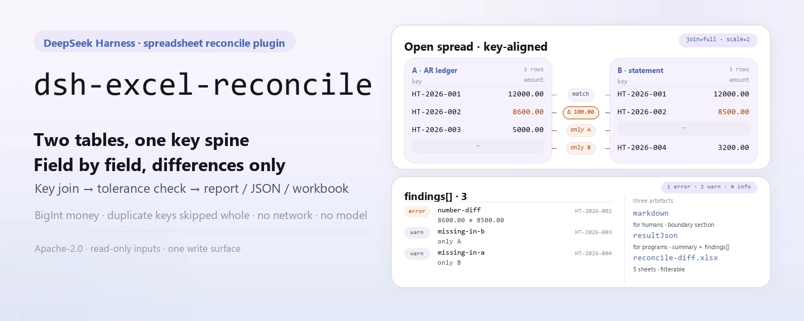

<div align="center">

<picture>
  <source media="(prefers-color-scheme: dark)" srcset="docs/assets/dsh-excel-reconcile-hero-en-dark.webp">
  
</picture>

# dsh-excel-reconcile

**Alinea dos tablas Excel/CSV por una clave y obtén cada campo que no coincide: solo diferencias, sin dictamen.**

Un plugin de conciliación para DeepSeek Harness: une dos tablas por claves declaradas, compara campos declarados con tolerancias declaradas y produce un informe Markdown, un resultado JSON y un libro de diferencias; el dinero se compara en unidades menores enteras y una clave duplicada se omite entera en lugar de emparejarse de forma arbitraria.

[Instalar](#instalación-en-tres-pasos) · [Configuración](#configuración) · [FAQ](#faq) · [简体中文](README.md) · [English](README.en.md) · [Español](README.es.md) · [Português](README.pt.md) · [हिन्दी](README.hi.md)

[](LICENSE)
[](#compatibilidad)
[](https://www.npmjs.com/package/dsh-excel-reconcile)
[](https://github.com/PerryLink/dsh-excel-reconcile/actions/workflows/ci.yml)
[](#compatibilidad)

[](https://github.com/PerryLink/dsh-excel-reconcile/stargazers)
[](https://www.npmjs.com/package/dsh-excel-reconcile)
[](https://dshfind.com/en/plugins/PerryLink/dsh-excel-reconcile?ref=badge)
[](https://securityscorecards.dev/viewer/?uri=github.com/PerryLink/dsh-excel-reconcile)

```sh
dsh plugin --profile <name> add dsh-excel-reconcile
```

</div>

<sub>Plugin de la comunidad, no afiliado a DeepSeek. Repositorio canónico: <https://github.com/PerryLink/dsh-excel-reconcile>.</sub>

## Qué es

`dsh-excel-reconcile` alinea dos tablas (`.xlsx` / `.xlsm` / `.csv` / tablas `.docx`) por las claves configuradas, compara campo por campo y produce tres artefactos: un informe Markdown para personas, un resultado JSON para programas y un libro de diferencias (cinco hojas) para quien revisa. Cada llamada hace exactamente una conciliación: claves, campos comparados, modo de unión y tolerancias viajan con la petición como YAML/JSON; el paquete no trae un paquete de reglas fijo.

Concilia, no dictamina: una diferencia significa que los dos lados no coinciden, no que uno esté mal. El dinero se compara en unidades menores enteras (BigInt), nunca en coma flotante, así que `12.3` y `12.30000000001` son el mismo importe con dos decimales; una clave que aparece dos veces se informa como `duplicate-key` y se omite entera en lugar de emparejarse arbitrariamente, porque emparejar la primera coincidencia oculta la diferencia que importa. ESM puro: sin peticiones de red ni llamadas al modelo.

<picture>
  <source media="(prefers-color-scheme: dark)" srcset="docs/assets/dsh-excel-reconcile-flow-v5-dark.svg">
  
</picture>

## Instalación en tres pasos

1. **Instala**:

   ```sh
   dsh plugin --profile <name> add dsh-excel-reconcile
   dsh --profile <name> --dump-config | grep 'dsh-excel-reconcile'
   ```

   El plugin se registra como una fila del patch del bundle (`cordis.patch.yml` solo hace `insert` de su propia fila); la herramienta que expone se llama `excel_reconcile`.

2. **Configuración mínima** (patch del perfil; las tres claves son opcionales):

   ```yaml
   - insert:
       - id: dsh-excel-reconcile
         name: dsh-excel-reconcile
         config:
           timeoutMs: 120000
           scale: 2
           diffWorkbook: reconcile-diff.xlsx
   ```

3. **Verifica que monta**: pide al modelo que llame a `excel_reconcile` en una sesión, o ejecuta el ejemplo incluido desde un checkout (antes `pnpm install && pnpm run build`; el ejemplo carga `lib/index.mjs`):

   ```sh
   node samples/quickstart/run.mjs --check
   ```

   ```
   $ node samples/quickstart/run.mjs
   excel_reconcile: 3 finding(s) — 1 error, 2 warn, 0 info
   rows: A=3 B=3, matched 2, only A=1, only B=1, duplicate keys=0
   ```

   *Observed from `docs/assets/quickstart.log`; los valores esperados están en `samples/quickstart/expected/result.json`*

**Desinstalar**: `dsh plugin --profile <name> remove dsh-excel-reconcile` (o elimina la fila del patch del perfil).

## Capacidades clave

- **Alineación por clave (cuatro modos de unión)** — `join` es `full` (predeterminado, conserva ambos lados), `left`, `inner` o `right`; `a.keys` y `b.keys` se corresponden por posición y una longitud distinta falla en voz alta.
- **Comparación campo por campo con tolerancias declaradas** — cada entrada de `compare[]` declara `a` (y opcionalmente `b`), `kind` (`number`/`text`/`date`), `abs`/`rel`, `severity` y `label`; el margen numérico es `abs + rel × max(|A|, |B|)`.
- **Diferencias tipadas** — `number-diff`, `text-diff`, `date-diff`, `not-a-number`, `missing-in-a`, `missing-in-b`, `duplicate-key` y `empty-key`; cada hallazgo lleva clave, campo, ambos valores, delta, explicación y siguiente paso sugerido.
- **Tres artefactos de una pasada** — el informe Markdown es para leer, `resultJson` para programas y el libro de diferencias para filtrar; si el libro no se puede escribir, sus bytes vuelven igualmente en `workbookBase64`, así que un entorno de solo lectura nunca pierde el resultado en silencio.
- **El dinero nunca pasa por coma flotante** — los importes se convierten a unidades menores BigInt con `scale` (2 por defecto) antes de comparar, así que `12.3` y `12.30000000001` son el mismo importe.
- **No adivina** — una clave duplicada se omite entera; una clave vacía informa `empty-key`; un lado vacío se anota en `warnings`; una columna clave ausente falla en voz alta, y una columna comparada ausente se informa fila por fila en lugar de rellenarse con blancos.

### Qué responde

- ¿Qué claves están en un lado y no en el otro?
- ¿Qué filas emparejadas discrepan, en qué campo y cuánto?
- ¿Supera la discrepancia la tolerancia que configuré?
- ¿Qué claves no pueden compararse por estar duplicadas?

### Cómo se ve la salida

La configuración de conciliación viaja con la petición (texto YAML o JSON):

```yaml
a: { table: 应收, keys: [合同号] }
b: { table: 对账单, keys: [合同号] }
join: full
compare:
  - { a: 客户, kind: text }
  - { a: 金额, kind: number, abs: 0.01 }
  - { a: 到期日, kind: date }
```

El libro de diferencias tiene cinco hojas (los nombres forman parte del artefacto):

```text
汇总, 差异明细, 仅A存在, 仅B存在, 合并结果
```

`差异明细` guarda una fila por diferencia, congela las 3 primeras columnas y tiene un orden de columnas fijo:

```text
序号, 问题类型, 严重程度, 主键, 字段, A 侧, B 侧, 差异, 说明, 建议处理, 处理状态
```

## Configuración

Todas las opciones son campos Schemastery `Config` (sobrescribibles desde cordis.yml). Una sobrescritura por id reemplaza la fila entera: repite cada clave que necesites.

| Clave | Predeterminado | Significado |
|---|---|---|
| `timeoutMs` | `120000` | Presupuesto de timeout de la herramienta en milisegundos, pasado a `defineTool` |
| `scale` | `2` | Decimales para comparar dinero; también se usa para convertir tolerancias |
| `diffWorkbook` | `reconcile-diff.xlsx` | Nombre del archivo del libro de diferencias (relativo al cwd del proceso host); vacío devuelve solo base64 y no escribe |

> La documentación antigua listaba `rulesFile`; no es una clave de configuración de este plugin. `rules/excel-reconcile.yaml` es un marcador del paquete de reglas (`rules: []`), y cada conciliación lleva su propia configuración con la petición. El schema tiene exactamente las tres claves de arriba.

<details>
<summary>Configuración de conciliación (viaja con la petición, no es configuración del plugin)</summary>

| Campo | Significado |
|---|---|
| `a.table`, `a.keys` | Nombre de tabla y campos clave del lado A |
| `b.table`, `b.keys` | Nombre de tabla y campos clave del lado B, alineados por posición con A |
| `join` | `full` (predeterminado), `left`, `inner`, `right` |
| `compare[]` | Campos a comparar: `a`, `b`, `kind` (`number`/`text`/`date`), `abs`, `rel`, `severity`, `label` |
| `duplicates` | `reject` (predeterminado) informa y omite; `aggregate` está reservado (ver Limitaciones conocidas) |
| `scale` | Decimales para dinero, 2 por defecto |

</details>

## FAQ

<details>
<summary>¿Modifica mis archivos de origen? ¿Dónde va la salida?</summary>

No. Ambas entradas se leen con `readFile` y las parsea `dsh-table-ingest`; el plugin nunca las reescribe. La única escritura implícita es el libro de diferencias en la ruta `diffWorkbook` (por defecto `reconcile-diff.xlsx`, relativa al cwd del proceso host); el argumento explícito `outFile` de la herramienta la sustituye. Si el volumen es de solo lectura, los bytes vuelven igualmente en base64. No hay peticiones de red ni llamadas al modelo en ningún punto.

</details>

<details>
<summary>¿Por qué se omite una clave duplicada en lugar de compararla?</summary>

Una clave duplicada puede corresponder a varias filas y emparejar la primera oculta la diferencia que importa, así que el valor predeterminado informa un hallazgo `duplicate-key` (error) y omite la clave entera. `duplicates: aggregate` está reservado: la versión actual no agrega — con `aggregate` deja de informar duplicados pero sigue comparando la primera fila de esa clave. Para trabajar uno-a-muchos, agrega o divide la clave antes.

</details>

<details>
<summary>¿Se redondean los importes? ¿Cómo se calcula la tolerancia?</summary>

Los importes se convierten a unidades menores enteras con `scale` antes de comparar, y los dígitos que exceden `scale` se truncan, no se redondean: `12.345` se compara como `12.34` con `scale: 2`. El margen numérico es `abs + rel × max(|A|, |B|)`; ambos valen 0 por defecto, lo que exige coincidencia exacta. Las tolerancias son configuración, no normativa.

</details>

<details>
<summary>¿Qué pasa con una fila ausente, una columna ausente o una clave vacía?</summary>

Una fila ausente la decide `join`: `full`/`left` informan «solo A» como `missing-in-b`, `full`/`right` informan «solo B» como `missing-in-a`, e `inner` no informa ninguna. Cuando falta una columna en un lado, cada fila emparejada informa una diferencia en ese campo en lugar de omitirla — a propósito, porque una columna perdida no debe leerse como acuerdo. Una fila con clave vacía informa `empty-key` y se omite; una tabla ausente, una columna clave ausente o un número de claves distinto lanzan `ReconcileError`.

</details>

<details>
<summary>¿La herramienta no aparece, o `dsh plugin add` rechaza el paquete?</summary>

Primero confirma que `main` resuelve a `lib/index.mjs` y que `pnpm run build` lo generó de verdad; este paquete publica el `lib/` compilado. Un rechazo de instalación suele ser un problema de rango de peer: el rango de `@deepseek-ai/dsh-tools` cubre `0.1.x` y `0.2.x`, así que un host fuera de él necesita una exención explícita. Si una llamada dice que la configuración de conciliación no se puede parsear, revisa la indentación YAML y que estén `a.table`/`b.table`.

</details>

## Límites de seguridad

- **Entradas de solo lectura, una sola superficie de escritura.** Ambas entradas solo se leen; el plugin nunca las reescribe. La única escritura implícita es el libro de diferencias en `diffWorkbook`; la escritura explícita es el argumento `outFile` de la herramienta.
- **Sin veredicto de cumplimiento, sin dictamen.** Una diferencia no es un error: el informe siempre lleva una sección de «límite» que dice que solo lista diferencias literales, que no decide qué lado tiene razón y que las tolerancias son configuración, no normativa; `suggestion` solo propone la siguiente comprobación.
- **Fallo cerrado y en voz alta.** Una configuración que no se puede parsear, un `a.table`/`b.table` ausente, un nombre de tabla desconocido, un número de claves distinto, una columna clave ausente o un archivo del que no se puede extraer una tabla lanzan `ReconcileError`: no se adivina nada ni se produce un «sin diferencias» silencioso.
- **Sin red, sin llamadas al modelo.** ESM puro; `dsh-table-ingest` parsea OOXML/CSV localmente. No se leen credenciales ni se hacen peticiones.
- **Una escritura fallida no es un éxito silencioso.** Cuando el libro no se puede escribir, `workbookPath` queda vacío pero `workbookBase64` sigue llevando los bytes completos, así que quien llama puede persistirlos.
- **Los registros son efectos.** `apply` devuelve directamente el disposer de `ctx.tools.register(...)`; parar o recargar en caliente desregistra la herramienta.

## Limitaciones conocidas

- **Unión de un solo nivel.** Sin joins encadenados (A↔B↔C); divide una conciliación multi-tabla en varias llamadas.
- **Una clave duplicada nunca se empareja.** `duplicates: aggregate` todavía no agrega: con `aggregate` deja de informar `duplicate-key` pero sigue comparando la primera fila de esa clave (ver la segunda entrada del FAQ).
- **Los importes se truncan en la escala configurada.** Los dígitos que exceden `scale` se descartan antes de comparar; sube `scale` si necesitas más precisión en lugar de esperar redondeo.
- **Una columna ausente amplifica las diferencias.** Cuando a un lado le falta una columna, cada fila emparejada informa una diferencia en ese campo en lugar de omitirla.
- **No codifica ninguna cláusula.** El esquema de conciliación es propio: claves, campos comparados, modo de unión, tolerancia y severidad. Es deliberado: una conciliación no tiene una base normativa que citar, e inventarla haría que el informe pareciera más autoritativo de lo que es.
- **No hay directorio de evidencia.** El paquete de reglas está vacío por diseño (`rules: []` en `rules/excel-reconcile.yaml`) y cada conciliación lleva su propia configuración; `pnpm run check:citations` espera 0 segments / 0 placeholders / 0 untraceable.
- **Depende de partes OOXML.** `sharedStrings.xml`, `cellXfs`/`numFmtId`, `workbook.xml` y `_rels` los lee `dsh-table-ingest`; cuando no se puede extraer una tabla, la llamada falla e informa cuántas tablas candidatas encontró.
- **Sin UI.** Una herramienta puramente host-side sin mitad de cliente; toda interacción pasa por la llamada a la herramienta `excel_reconcile`.
- **Una clave vacía nunca se empareja por posición.** Una fila con clave vacía solo informa `empty-key`, nunca una contraparte inferida.

## Interoperabilidad con otros plugins DSH

- **Solo se inyecta el servicio `tools`** (`inject = ['tools']`); no depende de ninguna otra clave de servicio ni la provee.
- **Se registra exactamente una herramienta.** `excel_reconcile` se exporta mediante la constante `TOOL_NAME`; no se registra ningún comando, slot de cliente ni ruta `webServer`, así que nunca compite por un asiento de slot ni por un prefijo HTTP.
- **Sin listeners de eventos compartidos.** No usa `ctx.on()`, así que no participa en el orden de `agent/pre-step`, `tools/post-execute` ni de ninguna otra cadena de eventos, y no puede cortocircuitar la cadena de otro plugin.
- **La capa de patch solo hace `insert` de su propia fila**, nunca sobrescribe el `config` de una fila incluida.
- **Sin mutación global.** No parchea prototipos, no escribe `process.env` ni reemplaza el fetch global.
- **Los registros son efectos.** Véase el último punto de Límites de seguridad.

## Compatibilidad

| Superficie | Estado |
|---|---|
| Harness | `engines.dsh` es `>=0.2.1-0 <0.3.0`; el rango peer de `@deepseek-ai/dsh-tools` es `>=0.1.2-rc.1 <0.2.0 \|\| >=0.2.0-0 <0.3.0` |
| Node | `^22.19.0 \|\| >=24.0.0` |
| Plataformas | Donde corra DSH (ESM puro; sin código nativo, sin red, sin llamada al modelo) |
| Entrada | Tablas `.xlsx` / `.xlsm` / `.csv` / `.docx` |
| Modelo | Modelos de texto totalmente soportados; el resultado de la herramienta es Markdown y no requiere capacidades extra del modelo |

## Ecosistema y calidad

- [Página del plugin en dshfind](https://dshfind.com/en/plugins/PerryLink/dsh-excel-reconcile) (instalaciones y ranking)
- [Informe de OpenSSF Scorecard](https://securityscorecards.dev/viewer/?uri=github.com/PerryLink/dsh-excel-reconcile) (impulsado por [.github/workflows/scorecard.yml](.github/workflows/scorecard.yml))
- [Familia de plugins PerryLink](https://github.com/PerryLink) (todos Apache-2.0)
- [Base de conocimiento del ecosistema](https://perrylink.github.io/dsh-plugin-guide/) — guía de desarrollo · datos de selección · criterios de mantenimiento

## Desarrollo

```sh
pnpm install
pnpm run typecheck
pnpm test
pnpm run build
pnpm run verify:self-contained
pnpm run check:lockfile
pnpm run check:readmes
pnpm run check:citations
node samples/quickstart/run.mjs --check
node ../scripts/sync-shared.mjs dsh-excel-reconcile
```

Este repositorio no publica datos de benchmark, así que no hay sección de datos medidos ni gráfico de evidencia. Las imágenes del README las genera programáticamente [`scripts/gen-readme-assets.py`](scripts/gen-readme-assets.py) (Python + Pillow): escribe los cuatro banners (zh/en × claro/oscuro) y los dos SVG estructurales en `docs/assets/`, se puede reejecutar sin riesgo, contiene únicamente tokens de comando, claves del ejemplo y etiquetas breves, y los dos estructurales los comparten los cinco idiomas. Capturas de terminal: [docs/assets/quickstart.png](docs/assets/quickstart.png) y [docs/assets/quickstart.log](docs/assets/quickstart.log).

Topics: `dsh`, `dsh-plugin`, `deepseek-harness`, `deepseek`, `cordis`, `reconcile`, `excel`, `csv`, `diff`, `join`

## Familia y agradecimientos

Este proyecto forma parte de la familia de plugins de DeepSeek Harness de [PerryLink](https://github.com/PerryLink) (todos Apache-2.0). Si te resulta útil, **una estrella ayuda a que la siguiente persona lo encuentre** — no hay nada bloqueado tras ella.

- [@PerryLink](https://github.com/PerryLink) — creador y mantenedor: el modelo de conciliación (dinero BigInt, cuatro modos de unión, política de claves duplicadas), el libro de diferencias, la herramienta `excel_reconcile` y la documentación en cinco idiomas.

<details>
<summary>Expandir todos los plugins</summary>

| Plugin | Estado |
|---|---|
| **[dsh-aqua-input-check](https://github.com/PerryLink/dsh-aqua-input-check)** |  |
| **[dsh-archive-check](https://github.com/PerryLink/dsh-archive-check)** |  |
| **[dsh-auto-review](https://github.com/PerryLink/dsh-auto-review)** |  |
| **[dsh-autotier](https://github.com/PerryLink/dsh-autotier)** | 🧊 CONGELADO — ver el README del repo |
| **[dsh-bid-ca-precheck](https://github.com/PerryLink/dsh-bid-ca-precheck)** |  |
| **[dsh-bid-qual-check](https://github.com/PerryLink/dsh-bid-qual-check)** |  |
| **[dsh-cert-mcp](https://github.com/PerryLink/dsh-cert-mcp)** | 🧊 CONGELADO — ver el README del repo |
| **[dsh-checkpoint-rewind](https://github.com/PerryLink/dsh-checkpoint-rewind)** |  |
| **[dsh-click](https://github.com/PerryLink/dsh-click)** |  |
| **[dsh-composer-history](https://github.com/PerryLink/dsh-composer-history)** |  |
| **[dsh-contract-stance](https://github.com/PerryLink/dsh-contract-stance)** |  |
| **[dsh-customs-doc-check](https://github.com/PerryLink/dsh-customs-doc-check)** |  |
| **[dsh-data-quality](https://github.com/PerryLink/dsh-data-quality)** | 🧊 CONGELADO — ver el README del repo |
| **[dsh-demurrage-ledger](https://github.com/PerryLink/dsh-demurrage-ledger)** |  |
| **[dsh-doublecheck](https://github.com/PerryLink/dsh-doublecheck)** |  |
| **[dsh-drill-script-check](https://github.com/PerryLink/dsh-drill-script-check)** |  |
| **[dsh-eia-guide-check](https://github.com/PerryLink/dsh-eia-guide-check)** |  |
| **[dsh-emergency-plan](https://github.com/PerryLink/dsh-emergency-plan)** |  |
| **[dsh-essay-rubric-check](https://github.com/PerryLink/dsh-essay-rubric-check)** |  |
| **[dsh-evidence-check](https://github.com/PerryLink/dsh-evidence-check)** |  |
| **[dsh-export-ctl-check](https://github.com/PerryLink/dsh-export-ctl-check)** |  |
| **[dsh-fast](https://github.com/PerryLink/dsh-fast)** |  |
| **[dsh-fmea-table-check](https://github.com/PerryLink/dsh-fmea-table-check)** |  |
| **[dsh-forecast-penalty](https://github.com/PerryLink/dsh-forecast-penalty)** |  |
| **[dsh-fund-research](https://github.com/PerryLink/dsh-fund-research)** |  |
| **[dsh-github](https://github.com/PerryLink/dsh-github)** |  |
| **[dsh-gongwen-flow-check](https://github.com/PerryLink/dsh-gongwen-flow-check)** |  |
| **[dsh-gongwen-word-check](https://github.com/PerryLink/dsh-gongwen-word-check)** |  |
| **[dsh-guard-plan-qc](https://github.com/PerryLink/dsh-guard-plan-qc)** |  |
| **[dsh-hazchem-check](https://github.com/PerryLink/dsh-hazchem-check)** |  |
| **[dsh-hazplan-check](https://github.com/PerryLink/dsh-hazplan-check)** |  |
| **[dsh-hidden-risk-map](https://github.com/PerryLink/dsh-hidden-risk-map)** |  |
| **[dsh-hs-classify](https://github.com/PerryLink/dsh-hs-classify)** |  |
| **[dsh-icd-rule-check](https://github.com/PerryLink/dsh-icd-rule-check)** |  |
| **[dsh-industry-research](https://github.com/PerryLink/dsh-industry-research)** |  |
| **[dsh-lawcite-adapter](https://github.com/PerryLink/dsh-lawcite-adapter)** |  |
| **[dsh-laya](https://github.com/PerryLink/dsh-laya)** |  |
| **[dsh-lc-doc-check](https://github.com/PerryLink/dsh-lc-doc-check)** |  |
| **[dsh-learning-gap-check](https://github.com/PerryLink/dsh-learning-gap-check)** |  |
| **[dsh-library](https://github.com/PerryLink/dsh-library)** |  |
| **[dsh-local-ai](https://github.com/PerryLink/dsh-local-ai)** |  |
| **[dsh-lsp-actions](https://github.com/PerryLink/dsh-lsp-actions)** |  |
| **[dsh-mask](https://github.com/PerryLink/dsh-mask)** |  |
| **[dsh-mcp-panel](https://github.com/PerryLink/dsh-mcp-panel)** |  |
| **[dsh-medrec-qc](https://github.com/PerryLink/dsh-medrec-qc)** |  |
| **[dsh-memento](https://github.com/PerryLink/dsh-memento)** | 🧊 CONGELADO — ver el README del repo |
| **[dsh-nsfc-form-check](https://github.com/PerryLink/dsh-nsfc-form-check)** |  |
| **[dsh-nurse-record-check](https://github.com/PerryLink/dsh-nurse-record-check)** |  |
| **[dsh-observe](https://github.com/PerryLink/dsh-observe)** |  |
| **[dsh-origin-rvc-check](https://github.com/PerryLink/dsh-origin-rvc-check)** |  |
| **[dsh-ota-review-check](https://github.com/PerryLink/dsh-ota-review-check)** |  |
| **[dsh-output-styles](https://github.com/PerryLink/dsh-output-styles)** |  |
| **[dsh-paper-doc-adapter](https://github.com/PerryLink/dsh-paper-doc-adapter)** |  |
| **[dsh-permission-rules](https://github.com/PerryLink/dsh-permission-rules)** |  |
| **[dsh-permit-report-check](https://github.com/PerryLink/dsh-permit-report-check)** |  |
| **[dsh-pipeline-check](https://github.com/PerryLink/dsh-pipeline-check)** |  |
| **[dsh-pleading-draft](https://github.com/PerryLink/dsh-pleading-draft)** |  |
| **[dsh-plugin-doctor](https://github.com/PerryLink/dsh-plugin-doctor)** | 🚫 RETIRADO (repo archivado) |
| **[dsh-plugin-guide](https://github.com/PerryLink/dsh-plugin-guide)** |  |
| **[dsh-plugin-kit](https://github.com/PerryLink/dsh-plugin-kit)** | 🚫 RETIRADO (repo archivado) |
| **[dsh-plugin-upgrade](https://github.com/PerryLink/dsh-plugin-upgrade)** | 🚫 RETIRADO (repo archivado) |
| **[dsh-policy-brief-draft](https://github.com/PerryLink/dsh-policy-brief-draft)** |  |
| **[dsh-power-loss-split](https://github.com/PerryLink/dsh-power-loss-split)** |  |
| **[dsh-power-ticket-check](https://github.com/PerryLink/dsh-power-ticket-check)** |  |
| **[dsh-ppap-check](https://github.com/PerryLink/dsh-ppap-check)** |  |
| **[dsh-protest-deadline](https://github.com/PerryLink/dsh-protest-deadline)** |  |
| **[dsh-railway-window](https://github.com/PerryLink/dsh-railway-window)** |  |
| **[dsh-repair-order-qc](https://github.com/PerryLink/dsh-repair-order-qc)** |  |
| **[dsh-research-report](https://github.com/PerryLink/dsh-research-report)** |  |
| **[dsh-review-reply-check](https://github.com/PerryLink/dsh-review-reply-check)** |  |
| **[dsh-rulefile-check](https://github.com/PerryLink/dsh-rulefile-check)** |  |
| **[dsh-safety-brief-check](https://github.com/PerryLink/dsh-safety-brief-check)** |  |
| **[dsh-score](https://github.com/PerryLink/dsh-score)** | 🧊 CONGELADO — ver el README del repo |
| **[dsh-session-sync](https://github.com/PerryLink/dsh-session-sync)** |  |
| **[dsh-site-log-check](https://github.com/PerryLink/dsh-site-log-check)** |  |
| **[dsh-skill-pack-security](https://github.com/PerryLink/dsh-skill-pack-security)** |  |
| **[dsh-soe-decision-check](https://github.com/PerryLink/dsh-soe-decision-check)** |  |
| **[dsh-soilwater-check](https://github.com/PerryLink/dsh-soilwater-check)** |  |
| **[dsh-sop-sync-check](https://github.com/PerryLink/dsh-sop-sync-check)** |  |
| **[dsh-spc-gbt-adapter](https://github.com/PerryLink/dsh-spc-gbt-adapter)** |  |
| **[dsh-talk](https://github.com/PerryLink/dsh-talk)** |  |
| **[dsh-tender-extract](https://github.com/PerryLink/dsh-tender-extract)** |  |
| **[dsh-tender-matrix](https://github.com/PerryLink/dsh-tender-matrix)** |  |
| **[dsh-test-drive](https://github.com/PerryLink/dsh-test-drive)** |  |
| **[dsh-ticktick](https://github.com/PerryLink/dsh-ticktick)** | 🚫 RETIRADO (repo archivado) |
| **[dsh-translate](https://github.com/PerryLink/dsh-translate)** |  |
| **[dsh-warranty-calc](https://github.com/PerryLink/dsh-warranty-calc)** |  |
| **[dsh-budget](https://github.com/PerryLink/dsh-budget)** | 🧊 CONGELADO — ver el README del repo |
| **[dsh-claude-move](https://github.com/PerryLink/dsh-claude-move)** | 🧊 CONGELADO — ver el README del repo |
| **[dsh-defend](https://github.com/PerryLink/dsh-defend)** | 🧊 CONGELADO — ver el README del repo |
| **[dsh-draw](https://github.com/PerryLink/dsh-draw)** | 🧊 CONGELADO — ver el README del repo |
| **[dsh-reach](https://github.com/PerryLink/dsh-reach)** | 🧊 CONGELADO — ver el README del repo |
| **[dsh-background-agents](https://github.com/PerryLink/dsh-background-agents)** | 🚫 RETIRADO (repo archivado) |
| **[dsh-session-pin](https://github.com/PerryLink/dsh-session-pin)** | 🚫 RETIRADO (repo archivado) |
| **[dsh-team-rooms](https://github.com/PerryLink/dsh-team-rooms)** | 🚫 RETIRADO (repo archivado) |

</details>

## Licencia

[LICENSE](LICENSE) (Apache License 2.0) © 2026 dsh-excel-reconcile contributors

<p align="center"><sub>Apache-2.0 · Plugin de la comunidad, no afiliado a DeepSeek.</sub></p>
