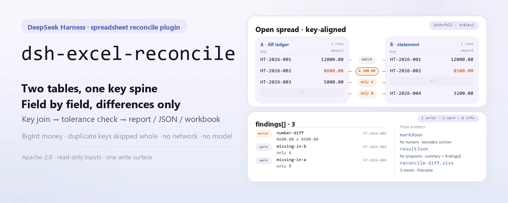
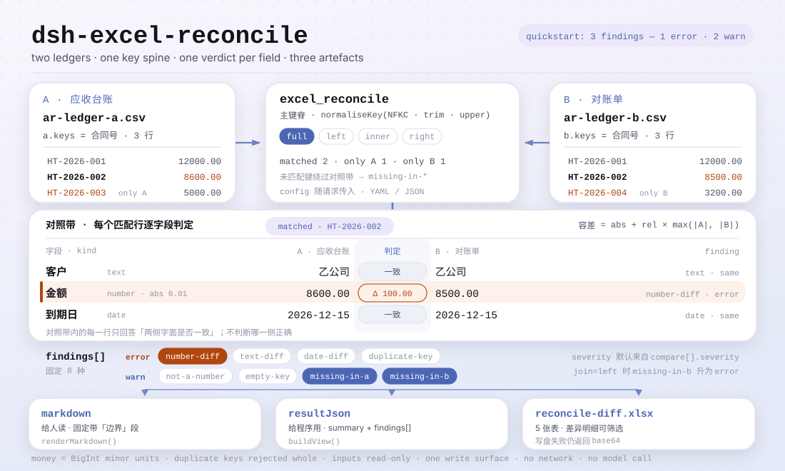

<div align="center">

<picture>
  <source media="(prefers-color-scheme: dark)" srcset="docs/assets/dsh-excel-reconcile-hero-en-dark.webp">
  
</picture>

# dsh-excel-reconcile

**दो Excel/CSV तालिकाओं को कुंजी पर मिलाएँ और हर वह फ़ील्ड पाएँ जो मेल नहीं खाता — केवल अंतर, कोई फ़ैसला नहीं।**

DeepSeek Harness के लिए एक मिलान (reconcile) प्लगइन: घोषित कुंजियों पर दो तालिकाएँ जोड़ें, घोषित फ़ील्ड की घोषित सहनशीलता के साथ तुलना करें, और Markdown रिपोर्ट, JSON परिणाम तथा अंतर वर्कबुक बनाएँ; धनराशि पूर्णांक लघु इकाइयों में तुलना होती है और दोहराई गई कुंजी को मनमाने ढंग से जोड़ने के बजाय पूरी तरह छोड़ दिया जाता है।

[इंस्टॉल](#तीन-चरणों-में-शुरुआत) · [कॉन्फ़िगरेशन](#कॉन्फ़िगरेशन) · [FAQ](#faq) · [简体中文](README.md) · [English](README.en.md) · [Español](README.es.md) · [Português](README.pt.md) · [हिन्दी](README.hi.md)

[](LICENSE)
[](#संगतता)
[](https://www.npmjs.com/package/dsh-excel-reconcile)
[](https://github.com/PerryLink/dsh-excel-reconcile/actions/workflows/ci.yml)
[](#संगतता)

[](https://github.com/PerryLink/dsh-excel-reconcile/stargazers)
[](https://www.npmjs.com/package/dsh-excel-reconcile)
[](https://dshfind.com/en/plugins/PerryLink/dsh-excel-reconcile?ref=badge)
[](https://securityscorecards.dev/viewer/?uri=github.com/PerryLink/dsh-excel-reconcile)

```sh
dsh plugin --profile <name> add dsh-excel-reconcile
```

</div>

<sub>सामुदायिक प्लगइन, DeepSeek से असंबद्ध। कैनोनिकल रिपॉज़िटरी: <https://github.com/PerryLink/dsh-excel-reconcile>।</sub>

## यह क्या है

`dsh-excel-reconcile` दो तालिकाओं (`.xlsx` / `.xlsm` / `.csv` / `.docx` तालिकाएँ) को कॉन्फ़िगर की गई कुंजियों पर मिलाता है, फ़ील्ड-दर-फ़ील्ड तुलना करता है, और तीन चीज़ें बनाता है: लोगों के पढ़ने के लिए Markdown रिपोर्ट, प्रोग्राम के लिए JSON परिणाम, और समीक्षक के छानने के लिए अंतर वर्कबुक (पाँच शीट)। हर कॉल ठीक एक मिलान करती है: कुंजियाँ, तुलना के फ़ील्ड, जॉइन मोड और सहनशीलता अनुरोध के साथ YAML/JSON कॉन्फ़िगरेशन में आते हैं; पैकेज कोई निश्चित नियम-सेट नहीं लाता।

यह मिलान करता है, फ़ैसला नहीं: अंतर का मतलब है कि दोनों पक्ष सहमत नहीं हैं, यह नहीं कि कोई एक ग़लत है। धनराशि पूर्णांक लघु इकाइयों (BigInt) में तुलना होती है, फ़्लोटिंग पॉइंट में कभी नहीं, इसलिए `12.3` और `12.30000000001` दो दशमलव स्थानों पर एक ही राशि हैं; दो बार आने वाली कुंजी `duplicate-key` के रूप में दर्ज होकर पूरी छोड़ दी जाती है, मनमाने ढंग से जोड़ी नहीं जाती — पहली मिलान जोड़ने से वही अंतर छिप जाता है जो मायने रखता है। शुद्ध ESM: कोई नेटवर्क अनुरोध नहीं, कोई मॉडल कॉल नहीं।

<picture>
  <source media="(prefers-color-scheme: dark)" srcset="docs/assets/dsh-excel-reconcile-flow-v5-dark.svg">
  
</picture>

## तीन चरणों में शुरुआत

1. **इंस्टॉल करें**:

   ```sh
   dsh plugin --profile <name> add dsh-excel-reconcile
   dsh --profile <name> --dump-config | grep 'dsh-excel-reconcile'
   ```

   प्लगइन bundle patch की एक पंक्ति के रूप में पंजीकृत होता है (`cordis.patch.yml` केवल अपनी ही पंक्ति `insert` करता है); यह जो टूल देता है उसका नाम `excel_reconcile` है।

2. **न्यूनतम कॉन्फ़िग** (profile patch; तीनों कुंजियाँ वैकल्पिक हैं):

   ```yaml
   - insert:
       - id: dsh-excel-reconcile
         name: dsh-excel-reconcile
         config:
           timeoutMs: 120000
           scale: 2
           diffWorkbook: reconcile-diff.xlsx
   ```

3. **माउंट सत्यापित करें**: किसी सत्र में मॉडल से `excel_reconcile` कॉल करवाएँ, या चेकआउट से साथ दिया नमूना चलाएँ (पहले `pnpm install && pnpm run build`; नमूना `lib/index.mjs` लोड करता है):

   ```sh
   node samples/quickstart/run.mjs --check
   ```

   ```
   $ node samples/quickstart/run.mjs
   excel_reconcile: 3 finding(s) — 1 error, 2 warn, 0 info
   rows: A=3 B=3, matched 2, only A=1, only B=1, duplicate keys=0
   ```

   *Observed from `docs/assets/quickstart.log`; अपेक्षित मान `samples/quickstart/expected/result.json` में हैं*

**अनइंस्टॉल**: `dsh plugin --profile <name> remove dsh-excel-reconcile` (या profile patch से वह पंक्ति हटाएँ)।

## मुख्य क्षमताएँ

- **कुंजी पर मिलान (चार जॉइन मोड)** — `join` `full` (डिफ़ॉल्ट, दोनों पक्ष रखता है), `left`, `inner` या `right` है; `a.keys` और `b.keys` स्थान के अनुसार मेल खाते हैं और लंबाई अलग होने पर स्पष्ट त्रुटि होती है।
- **घोषित सहनशीलता के साथ फ़ील्ड-दर-फ़ील्ड तुलना** — `compare[]` की हर प्रविष्टि `a` (और वैकल्पिक `b`), `kind` (`number`/`text`/`date`), `abs`/`rel`, `severity` और `label` घोषित करती है; संख्यात्मक छूट `abs + rel × max(|A|, |B|)` है।
- **टाइप किए गए अंतर** — `number-diff`, `text-diff`, `date-diff`, `not-a-number`, `missing-in-a`, `missing-in-b`, `duplicate-key` और `empty-key`; हर निष्कर्ष के साथ कुंजी, फ़ील्ड, दोनों मान, डेल्टा, व्याख्या और सुझाया गया अगला कदम आता है।
- **एक ही बार में तीन आर्टिफ़ैक्ट** — Markdown रिपोर्ट पढ़ने के लिए, `resultJson` प्रोग्राम के लिए और अंतर वर्कबुक छानने के लिए; वर्कबुक लिखी न जा सके तो भी बाइट्स `workbookBase64` में लौटती हैं, इसलिए केवल-पढ़ने वाला सैंडबॉक्स परिणाम चुपचाप कभी नहीं खोता।
- **धनराशि फ़्लोटिंग पॉइंट को कभी नहीं छूती** — तुलना से पहले राशियाँ `scale` (डिफ़ॉल्ट 2) पर BigInt लघु इकाइयों में बदली जाती हैं, इसलिए `12.3` और `12.30000000001` एक ही राशि हैं।
- **अनुमान नहीं लगाता** — दोहराई गई कुंजी पूरी छोड़ दी जाती है; खाली कुंजी `empty-key` दर्ज करती है; खाली पक्ष `warnings` में दर्ज होता है; कुंजी स्तंभ न हो तो स्पष्ट त्रुटि होती है, और तुलना वाला स्तंभ न हो तो खाली मान से भरने के बजाय हर पंक्ति पर अंतर दर्ज होता है।

### यह किन सवालों का जवाब देता है

- कौन-सी कुंजियाँ एक पक्ष में हैं और दूसरे में नहीं?
- कौन-सी मिली हुई पंक्तियाँ असहमत हैं, किस फ़ील्ड में, और कितना?
- क्या अंतर मेरी कॉन्फ़िगर की गई सहनशीलता से बड़ा है?
- कौन-सी कुंजियाँ दोहराव के कारण तुलना ही नहीं हो सकतीं?

### आउटपुट कैसा दिखता है

मिलान का कॉन्फ़िगरेशन अनुरोध के साथ आता है (YAML या JSON टेक्स्ट):

```yaml
a: { table: 应收, keys: [合同号] }
b: { table: 对账单, keys: [合同号] }
join: full
compare:
  - { a: 客户, kind: text }
  - { a: 金额, kind: number, abs: 0.01 }
  - { a: 到期日, kind: date }
```

अंतर वर्कबुक में पाँच शीट हैं (शीट के नाम आर्टिफ़ैक्ट का हिस्सा हैं):

```text
汇总, 差异明细, 仅A存在, 仅B存在, 合并结果
```

`差异明细` में हर अंतर की एक पंक्ति होती है, पहले 3 स्तंभ स्थिर (freeze) रहते हैं, और स्तंभों का क्रम निश्चित है:

```text
序号, 问题类型, 严重程度, 主键, 字段, A 侧, B 侧, 差异, 说明, 建议处理, 处理状态
```

## कॉन्फ़िगरेशन

सभी समायोज्य Schemastery `Config` फ़ील्ड हैं (cordis.yml से बदले जा सकते हैं)। id के आधार पर ओवरराइड पूरी पंक्ति बदल देता है — ज़रूरत की हर कुंजी दोबारा लिखें।

| कुंजी | डिफ़ॉल्ट | अर्थ |
|---|---|---|
| `timeoutMs` | `120000` | टूल का टाइमआउट बजट मिलीसेकंड में, `defineTool` को दिया जाता है |
| `scale` | `2` | धनराशि तुलना के दशमलव स्थान; सहनशीलता बदलने में भी उपयोग |
| `diffWorkbook` | `reconcile-diff.xlsx` | अंतर वर्कबुक का फ़ाइल नाम (होस्ट प्रोसेस cwd के सापेक्ष); खाली होने पर केवल base64 लौटता है, लिखता नहीं |

> पुराने दस्तावेज़ में `rulesFile` सूचीबद्ध था; वह इस प्लगइन की कॉन्फ़िगरेशन कुंजी नहीं है। `rules/excel-reconcile.yaml` नियम-पैक का प्लेसहोल्डर है (`rules: []`), और हर मिलान अपना कॉन्फ़िगरेशन अनुरोध के साथ लाता है। स्कीमा में ठीक ऊपर की तीन कुंजियाँ हैं।

<details>
<summary>मिलान कॉन्फ़िगरेशन (अनुरोध के साथ आता है, प्लगइन कॉन्फ़िगरेशन नहीं)</summary>

| फ़ील्ड | अर्थ |
|---|---|
| `a.table`, `a.keys` | A पक्ष की तालिका का नाम और कुंजी फ़ील्ड |
| `b.table`, `b.keys` | B पक्ष की तालिका का नाम और कुंजी फ़ील्ड, A के साथ स्थान से मेल |
| `join` | `full` (डिफ़ॉल्ट), `left`, `inner`, `right` |
| `compare[]` | तुलना के फ़ील्ड: `a`, `b`, `kind` (`number`/`text`/`date`), `abs`, `rel`, `severity`, `label` |
| `duplicates` | `reject` (डिफ़ॉल्ट) दर्ज करके छोड़ता है; `aggregate` आरक्षित है (ज्ञात सीमाएँ देखें) |
| `scale` | धनराशि के दशमलव स्थान, डिफ़ॉल्ट 2 |

</details>

## FAQ

<details>
<summary>क्या यह मेरी मूल फ़ाइलें बदलता है? आउटपुट कहाँ जाता है?</summary>

नहीं। दोनों इनपुट `readFile` से पढ़े जाते हैं और `dsh-table-ingest` उन्हें पार्स करता है; प्लगइन उन्हें कभी वापस नहीं लिखता। एकमात्र अंतर्निहित लेखन `diffWorkbook` पथ पर अंतर वर्कबुक है (डिफ़ॉल्ट `reconcile-diff.xlsx`, होस्ट प्रोसेस cwd के सापेक्ष); टूल का स्पष्ट `outFile` तर्क उसे बदल देता है। वॉल्यूम केवल-पढ़ने वाला हो तो भी बाइट्स base64 में लौटती हैं। कहीं भी नेटवर्क अनुरोध या मॉडल कॉल नहीं होती।

</details>

<details>
<summary>दोहराई गई कुंजी को तुलना के बजाय क्यों छोड़ा जाता है?</summary>

दोहराई गई कुंजी कई पंक्तियों से मेल खा सकती है और पहली को जोड़ने से वही अंतर छिप जाता है जो मायने रखता है, इसलिए डिफ़ॉल्ट एक `duplicate-key` (error) निष्कर्ष दर्ज करके पूरी कुंजी छोड़ देता है। `duplicates: aggregate` आरक्षित है: मौजूदा संस्करण समूहन नहीं करता — `aggregate` सेट करने पर दोहराव दर्ज होना बंद हो जाता है पर उस कुंजी की पहली पंक्ति फिर भी तुलना में आती है। एक-से-अनेक के लिए पहले स्वयं समूहित करें या कुंजी बाँटें।

</details>

<details>
<summary>क्या राशियाँ गोल की जाती हैं? सहनशीलता कैसे निकलती है?</summary>

तुलना से पहले राशियाँ `scale` पर पूर्णांक लघु इकाइयों में बदली जाती हैं, और `scale` से आगे के अंक काटे जाते हैं, गोल नहीं किए जाते: `12.345` को `scale: 2` पर `12.34` माना जाता है। संख्यात्मक छूट `abs + rel × max(|A|, |B|)` है; दोनों डिफ़ॉल्ट रूप से 0 हैं, यानी पूरी बराबरी ज़रूरी है। सहनशीलता कॉन्फ़िगरेशन है, नियम नहीं।

</details>

<details>
<summary>पंक्ति, स्तंभ या कुंजी गायब होने पर क्या होता है?</summary>

गायब पंक्ति का फ़ैसला `join` करता है: `full`/`left` «केवल A» को `missing-in-b` बताते हैं, `full`/`right` «केवल B» को `missing-in-a`, और `inner` कोई भी नहीं बताता। किसी पक्ष में स्तंभ न हो तो हर मिली हुई पंक्ति उस फ़ील्ड पर अंतर दर्ज करती है, छोड़ती नहीं — यह जानबूझकर है, क्योंकि छूटा स्तंभ सहमति नहीं गिना जाना चाहिए। खाली कुंजी वाली पंक्ति `empty-key` दर्ज करके छोड़ दी जाती है; तालिका, कुंजी स्तंभ या कुंजियों की संख्या न मिलने पर सीधे `ReconcileError` फेंका जाता है।

</details>

<details>
<summary>टूल दिखता नहीं, या `dsh plugin add` पैकेज अस्वीकार करता है?</summary>

पहले पुष्टि करें कि `main` `lib/index.mjs` पर जाता है और `pnpm run build` ने उसे सचमुच बनाया है; यह पैकेज बना हुआ `lib/` प्रकाशित करता है। इंस्टॉल अस्वीकृति आम तौर पर peer रेंज की समस्या है: `@deepseek-ai/dsh-tools` की peer रेंज `0.1.x` और `0.2.x` को कवर करती है, इसलिए उससे बाहर के होस्ट को स्पष्ट छूट चाहिए। कॉल कहे कि मिलान कॉन्फ़िगरेशन पार्स नहीं हो सकता, तो YAML का इंडेंटेशन और `a.table`/`b.table` की मौजूदगी जाँचें।

</details>

## सुरक्षा सीमाएँ

- **इनपुट केवल-पढ़ने, लेखन की एक ही सतह।** दोनों इनपुट केवल पढ़े जाते हैं; प्लगइन उन्हें कभी वापस नहीं लिखता। एकमात्र अंतर्निहित लेखन `diffWorkbook` पर अंतर वर्कबुक है; स्पष्ट लेखन टूल का `outFile` तर्क है।
- **अनुपालन का फ़ैसला नहीं, कोई निर्णय नहीं।** अंतर त्रुटि नहीं है: रिपोर्ट में हमेशा «सीमा» अनुभाग होता है जो बताता है कि यह केवल शाब्दिक अंतर सूचीबद्ध करती है, यह नहीं तय करती कि कौन-सा पक्ष सही है, और सहनशीलता कॉन्फ़िगरेशन है, नियम नहीं; `suggestion` केवल अगली जाँच सुझाता है।
- **फ़ेल-क्लोज़्ड और स्पष्ट।** पार्स न होने वाला कॉन्फ़िगरेशन, गायब `a.table`/`b.table`, अज्ञात तालिका नाम, कुंजियों की संख्या में अंतर, गायब कुंजी स्तंभ, या ऐसी फ़ाइल जिससे तालिका नहीं निकलती — सब `ReconcileError` फेंकते हैं: कुछ अनुमान नहीं लगाया जाता और चुपचाप «कोई अंतर नहीं» नहीं बनता।
- **कोई नेटवर्क नहीं, कोई मॉडल कॉल नहीं।** शुद्ध ESM; `dsh-table-ingest` OOXML/CSV स्थानीय रूप से पार्स करता है। कोई क्रेडेंशियल नहीं पढ़ा जाता और कोई अनुरोध नहीं भेजा जाता।
- **असफल लेखन चुपचाप सफलता नहीं है।** वर्कबुक न लिखी जा सके तो `workbookPath` खाली रहता है पर `workbookBase64` में पूरी बाइट्स रहती हैं, इसलिए कॉलर उन्हें स्वयं सहेज सकता है।
- **पंजीकरण इफ़ेक्ट हैं।** `apply` सीधे `ctx.tools.register(...)` का disposer लौटाता है; रोकने या हॉट-रीलोड पर टूल अनरजिस्टर हो जाता है।

## ज्ञात सीमाएँ

- **जॉइन केवल एक स्तर का।** श्रृंखलाबद्ध जॉइन नहीं (A↔B↔C); बहु-तालिका मिलान को कई कॉल में बाँटें।
- **दोहराई गई कुंजी कभी नहीं जोड़ी जाती।** `duplicates: aggregate` अभी समूहन नहीं करता: `aggregate` सेट करने पर `duplicate-key` दर्ज होना बंद होता है पर उस कुंजी की पहली पंक्ति फिर भी तुलना में आती है (FAQ का दूसरा प्रविष्टि देखें)।
- **राशियाँ कॉन्फ़िगर किए गए दशमलव पर काटी जाती हैं।** `scale` से आगे के अंक तुलना से पहले हटा दिए जाते हैं; अधिक सटीकता चाहिए तो `scale` बढ़ाएँ, गोलाई की उम्मीद न करें।
- **गायब स्तंभ अंतर बढ़ा देता है।** किसी पक्ष में स्तंभ न हो तो हर मिली हुई पंक्ति उस फ़ील्ड पर अंतर दर्ज करती है, छोड़ती नहीं।
- **कोई धारा नहीं लिखी जाती।** मिलान का स्कीमा अपना है: कुंजियाँ, तुलना फ़ील्ड, जॉइन मोड, सहनशीलता, गंभीरता। यह जानबूझकर है — मिलान के पास उद्धृत करने योग्य कोई मानक आधार नहीं है, और नकली आधार रिपोर्ट को वास्तविकता से अधिक आधिकारिक दिखाता।
- **कोई साक्ष्य निर्देशिका नहीं।** नियम-पैक जानबूझकर खाली है (`rules/excel-reconcile.yaml` में `rules: []`) और हर मिलान अपना कॉन्फ़िगरेशन लाता है; `pnpm run check:citations` 0 segments / 0 placeholders / 0 untraceable की अपेक्षा करता है।
- **यह OOXML भागों पर निर्भर है।** `sharedStrings.xml`, `cellXfs`/`numFmtId`, `workbook.xml` और `_rels` को `dsh-table-ingest` पढ़ता है; तालिका न निकले तो कॉल त्रुटि देती है और बताती है कि कितनी उम्मीदवार तालिकाएँ मिलीं।
- **कोई UI नहीं।** शुद्ध host-side टूल, कोई क्लाइंट आधा नहीं; हर इंटरैक्शन `excel_reconcile` टूल कॉल से होता है।
- **खाली कुंजी स्थान से कभी नहीं जोड़ी जाती।** खाली कुंजी वाली पंक्ति केवल `empty-key` दर्ज करती है, कभी अनुमानित जोड़ी नहीं।

## अन्य DSH प्लगइनों के साथ इंटरऑपरेबिलिटी

- **केवल `tools` सेवा इंजेक्ट होती है** (`inject = ['tools']`); यह किसी अन्य सेवा कुंजी पर निर्भर नहीं और उसे देता भी नहीं।
- **ठीक एक टूल पंजीकृत होता है।** `excel_reconcile` `TOOL_NAME` स्थिरांक से निर्यात होता है; कोई कमांड, क्लाइंट स्लॉट या `webServer` रूट पंजीकृत नहीं होता, इसलिए यह कभी स्लॉट सीट या HTTP प्रीफ़िक्स के लिए नहीं लड़ता।
- **कोई साझा इवेंट लिसनर नहीं।** यह `ctx.on()` का उपयोग नहीं करता, इसलिए `agent/pre-step`, `tools/post-execute` या किसी अन्य इवेंट श्रृंखला के क्रम में भाग नहीं लेता और किसी दूसरे प्लगइन की श्रृंखला को शॉर्ट-सर्किट नहीं कर सकता।
- **patch परत केवल अपनी पंक्ति `insert` करती है**, कभी किसी अंतर्निहित पंक्ति का `config` नहीं बदलती।
- **कोई वैश्विक बदलाव नहीं।** प्रोटोटाइप नहीं बदलता, `process.env` नहीं लिखता, वैश्विक fetch नहीं बदलता।
- **पंजीकरण इफ़ेक्ट हैं।** सुरक्षा सीमाओं का अंतिम बिंदु देखें।

## संगतता

| सतह | स्थिति |
|---|---|
| Harness | `engines.dsh` `>=0.2.1-0 <0.3.0` है; `@deepseek-ai/dsh-tools` की peer रेंज `>=0.1.2-rc.1 <0.2.0 \|\| >=0.2.0-0 <0.3.0` है |
| Node | `^22.19.0 \|\| >=24.0.0` |
| प्लेटफ़ॉर्म | जहाँ DSH चले (शुद्ध ESM; कोई नेटिव कोड नहीं, कोई नेटवर्क नहीं, कोई मॉडल कॉल नहीं) |
| इनपुट | `.xlsx` / `.xlsm` / `.csv` / `.docx` तालिकाएँ |
| मॉडल | टेक्स्ट मॉडल पूरी तरह समर्थित; टूल का परिणाम Markdown है और अतिरिक्त मॉडल क्षमता नहीं चाहता |

## इकोसिस्टम और गुणवत्ता

- [dshfind प्लगइन पेज](https://dshfind.com/en/plugins/PerryLink/dsh-excel-reconcile) (इंस्टॉल और रैंकिंग)
- [OpenSSF Scorecard रिपोर्ट](https://securityscorecards.dev/viewer/?uri=github.com/PerryLink/dsh-excel-reconcile) ([.github/workflows/scorecard.yml](.github/workflows/scorecard.yml) से संचालित)
- [PerryLink प्लगइन परिवार](https://github.com/PerryLink) (सभी Apache-2.0)
- [इकोसिस्टम नॉलेज बेस](https://perrylink.github.io/dsh-plugin-guide/) — विकास गाइड · चयन डेटा · रखरखाव मानदंड

## डेवलपमेंट

```sh
pnpm install
pnpm run typecheck
pnpm test
pnpm run build
pnpm run verify:self-contained
pnpm run check:lockfile
pnpm run check:readmes
pnpm run check:citations
node samples/quickstart/run.mjs --check
node ../scripts/sync-shared.mjs dsh-excel-reconcile
```

यह रेपो benchmark डेटा प्रकाशित नहीं करता, इसलिए न «मापे गए डेटा» अनुभाग है न साक्ष्य चार्ट। README की छवियाँ [`scripts/gen-readme-assets.py`](scripts/gen-readme-assets.py) (Python + Pillow) से प्रोग्रामेटिक रूप से बनती हैं: यह `docs/assets/` में चार बैनर (zh/en × हल्का/गहरा) और दो संरचनात्मक SVG लिखता है, सुरक्षित रूप से दोबारा चलाया जा सकता है, इसमें केवल कमांड टोकन, नमूने की कुंजियाँ और संक्षिप्त लेबल होते हैं, और दोनों संरचनात्मक चित्र पाँचों भाषाएँ साझा करती हैं। टर्मिनल कैप्चर: [docs/assets/quickstart.png](docs/assets/quickstart.png) और [docs/assets/quickstart.log](docs/assets/quickstart.log)।

Topics: `dsh`, `dsh-plugin`, `deepseek-harness`, `deepseek`, `cordis`, `reconcile`, `excel`, `csv`, `diff`, `join`

## परिवार और आभार

यह प्रोजेक्ट [PerryLink](https://github.com/PerryLink) के DeepSeek Harness प्लगइन परिवार का हिस्सा है (सभी Apache-2.0)। अगर यह उपयोगी है, तो **एक स्टार अगली व्यक्ति को इसे खोजने में मदद करता है** — इसके पीछे कुछ भी बंद नहीं है।

- [@PerryLink](https://github.com/PerryLink) — निर्माता और अनुरक्षक: मिलान मॉडल (BigInt धनराशि, चार जॉइन मोड, दोहराई गई कुंजी नीति), अंतर वर्कबुक, `excel_reconcile` टूल और पाँच-भाषा दस्तावेज़।

<details>
<summary>सभी प्लगइन विस्तारित करें</summary>

| प्लगइन | स्थिति |
|---|---|
| **[dsh-aqua-input-check](https://github.com/PerryLink/dsh-aqua-input-check)** |  |
| **[dsh-archive-check](https://github.com/PerryLink/dsh-archive-check)** |  |
| **[dsh-auto-review](https://github.com/PerryLink/dsh-auto-review)** |  |
| **[dsh-autotier](https://github.com/PerryLink/dsh-autotier)** | 🧊 फ़्रोज़न — रेपो README देखें |
| **[dsh-bid-ca-precheck](https://github.com/PerryLink/dsh-bid-ca-precheck)** |  |
| **[dsh-bid-qual-check](https://github.com/PerryLink/dsh-bid-qual-check)** |  |
| **[dsh-cert-mcp](https://github.com/PerryLink/dsh-cert-mcp)** | 🧊 फ़्रोज़न — रेपो README देखें |
| **[dsh-checkpoint-rewind](https://github.com/PerryLink/dsh-checkpoint-rewind)** |  |
| **[dsh-click](https://github.com/PerryLink/dsh-click)** |  |
| **[dsh-composer-history](https://github.com/PerryLink/dsh-composer-history)** |  |
| **[dsh-contract-stance](https://github.com/PerryLink/dsh-contract-stance)** |  |
| **[dsh-customs-doc-check](https://github.com/PerryLink/dsh-customs-doc-check)** |  |
| **[dsh-data-quality](https://github.com/PerryLink/dsh-data-quality)** | 🧊 फ़्रोज़न — रेपो README देखें |
| **[dsh-demurrage-ledger](https://github.com/PerryLink/dsh-demurrage-ledger)** |  |
| **[dsh-doublecheck](https://github.com/PerryLink/dsh-doublecheck)** |  |
| **[dsh-drill-script-check](https://github.com/PerryLink/dsh-drill-script-check)** |  |
| **[dsh-eia-guide-check](https://github.com/PerryLink/dsh-eia-guide-check)** |  |
| **[dsh-emergency-plan](https://github.com/PerryLink/dsh-emergency-plan)** |  |
| **[dsh-essay-rubric-check](https://github.com/PerryLink/dsh-essay-rubric-check)** |  |
| **[dsh-evidence-check](https://github.com/PerryLink/dsh-evidence-check)** |  |
| **[dsh-export-ctl-check](https://github.com/PerryLink/dsh-export-ctl-check)** |  |
| **[dsh-fast](https://github.com/PerryLink/dsh-fast)** |  |
| **[dsh-fmea-table-check](https://github.com/PerryLink/dsh-fmea-table-check)** |  |
| **[dsh-forecast-penalty](https://github.com/PerryLink/dsh-forecast-penalty)** |  |
| **[dsh-fund-research](https://github.com/PerryLink/dsh-fund-research)** |  |
| **[dsh-github](https://github.com/PerryLink/dsh-github)** |  |
| **[dsh-gongwen-flow-check](https://github.com/PerryLink/dsh-gongwen-flow-check)** |  |
| **[dsh-gongwen-word-check](https://github.com/PerryLink/dsh-gongwen-word-check)** |  |
| **[dsh-guard-plan-qc](https://github.com/PerryLink/dsh-guard-plan-qc)** |  |
| **[dsh-hazchem-check](https://github.com/PerryLink/dsh-hazchem-check)** |  |
| **[dsh-hazplan-check](https://github.com/PerryLink/dsh-hazplan-check)** |  |
| **[dsh-hidden-risk-map](https://github.com/PerryLink/dsh-hidden-risk-map)** |  |
| **[dsh-hs-classify](https://github.com/PerryLink/dsh-hs-classify)** |  |
| **[dsh-icd-rule-check](https://github.com/PerryLink/dsh-icd-rule-check)** |  |
| **[dsh-industry-research](https://github.com/PerryLink/dsh-industry-research)** |  |
| **[dsh-lawcite-adapter](https://github.com/PerryLink/dsh-lawcite-adapter)** |  |
| **[dsh-laya](https://github.com/PerryLink/dsh-laya)** |  |
| **[dsh-lc-doc-check](https://github.com/PerryLink/dsh-lc-doc-check)** |  |
| **[dsh-learning-gap-check](https://github.com/PerryLink/dsh-learning-gap-check)** |  |
| **[dsh-library](https://github.com/PerryLink/dsh-library)** |  |
| **[dsh-local-ai](https://github.com/PerryLink/dsh-local-ai)** |  |
| **[dsh-lsp-actions](https://github.com/PerryLink/dsh-lsp-actions)** |  |
| **[dsh-mask](https://github.com/PerryLink/dsh-mask)** |  |
| **[dsh-mcp-panel](https://github.com/PerryLink/dsh-mcp-panel)** |  |
| **[dsh-medrec-qc](https://github.com/PerryLink/dsh-medrec-qc)** |  |
| **[dsh-memento](https://github.com/PerryLink/dsh-memento)** | 🧊 फ़्रोज़न — रेपो README देखें |
| **[dsh-nsfc-form-check](https://github.com/PerryLink/dsh-nsfc-form-check)** |  |
| **[dsh-nurse-record-check](https://github.com/PerryLink/dsh-nurse-record-check)** |  |
| **[dsh-observe](https://github.com/PerryLink/dsh-observe)** |  |
| **[dsh-origin-rvc-check](https://github.com/PerryLink/dsh-origin-rvc-check)** |  |
| **[dsh-ota-review-check](https://github.com/PerryLink/dsh-ota-review-check)** |  |
| **[dsh-output-styles](https://github.com/PerryLink/dsh-output-styles)** |  |
| **[dsh-paper-doc-adapter](https://github.com/PerryLink/dsh-paper-doc-adapter)** |  |
| **[dsh-permission-rules](https://github.com/PerryLink/dsh-permission-rules)** |  |
| **[dsh-permit-report-check](https://github.com/PerryLink/dsh-permit-report-check)** |  |
| **[dsh-pipeline-check](https://github.com/PerryLink/dsh-pipeline-check)** |  |
| **[dsh-pleading-draft](https://github.com/PerryLink/dsh-pleading-draft)** |  |
| **[dsh-plugin-doctor](https://github.com/PerryLink/dsh-plugin-doctor)** | 🚫 रिटायर्ड (रेपो संग्रहीत) |
| **[dsh-plugin-guide](https://github.com/PerryLink/dsh-plugin-guide)** |  |
| **[dsh-plugin-kit](https://github.com/PerryLink/dsh-plugin-kit)** | 🚫 रिटायर्ड (रेपो संग्रहीत) |
| **[dsh-plugin-upgrade](https://github.com/PerryLink/dsh-plugin-upgrade)** | 🚫 रिटायर्ड (रेपो संग्रहीत) |
| **[dsh-policy-brief-draft](https://github.com/PerryLink/dsh-policy-brief-draft)** |  |
| **[dsh-power-loss-split](https://github.com/PerryLink/dsh-power-loss-split)** |  |
| **[dsh-power-ticket-check](https://github.com/PerryLink/dsh-power-ticket-check)** |  |
| **[dsh-ppap-check](https://github.com/PerryLink/dsh-ppap-check)** |  |
| **[dsh-protest-deadline](https://github.com/PerryLink/dsh-protest-deadline)** |  |
| **[dsh-railway-window](https://github.com/PerryLink/dsh-railway-window)** |  |
| **[dsh-repair-order-qc](https://github.com/PerryLink/dsh-repair-order-qc)** |  |
| **[dsh-research-report](https://github.com/PerryLink/dsh-research-report)** |  |
| **[dsh-review-reply-check](https://github.com/PerryLink/dsh-review-reply-check)** |  |
| **[dsh-rulefile-check](https://github.com/PerryLink/dsh-rulefile-check)** |  |
| **[dsh-safety-brief-check](https://github.com/PerryLink/dsh-safety-brief-check)** |  |
| **[dsh-score](https://github.com/PerryLink/dsh-score)** | 🧊 फ़्रोज़न — रेपो README देखें |
| **[dsh-session-sync](https://github.com/PerryLink/dsh-session-sync)** |  |
| **[dsh-site-log-check](https://github.com/PerryLink/dsh-site-log-check)** |  |
| **[dsh-skill-pack-security](https://github.com/PerryLink/dsh-skill-pack-security)** |  |
| **[dsh-soe-decision-check](https://github.com/PerryLink/dsh-soe-decision-check)** |  |
| **[dsh-soilwater-check](https://github.com/PerryLink/dsh-soilwater-check)** |  |
| **[dsh-sop-sync-check](https://github.com/PerryLink/dsh-sop-sync-check)** |  |
| **[dsh-spc-gbt-adapter](https://github.com/PerryLink/dsh-spc-gbt-adapter)** |  |
| **[dsh-talk](https://github.com/PerryLink/dsh-talk)** |  |
| **[dsh-tender-extract](https://github.com/PerryLink/dsh-tender-extract)** |  |
| **[dsh-tender-matrix](https://github.com/PerryLink/dsh-tender-matrix)** |  |
| **[dsh-test-drive](https://github.com/PerryLink/dsh-test-drive)** |  |
| **[dsh-ticktick](https://github.com/PerryLink/dsh-ticktick)** | 🚫 रिटायर्ड (रेपो संग्रहीत) |
| **[dsh-translate](https://github.com/PerryLink/dsh-translate)** |  |
| **[dsh-warranty-calc](https://github.com/PerryLink/dsh-warranty-calc)** |  |
| **[dsh-budget](https://github.com/PerryLink/dsh-budget)** | 🧊 फ़्रोज़न — रेपो README देखें |
| **[dsh-claude-move](https://github.com/PerryLink/dsh-claude-move)** | 🧊 फ़्रोज़न — रेपो README देखें |
| **[dsh-defend](https://github.com/PerryLink/dsh-defend)** | 🧊 फ़्रोज़न — रेपो README देखें |
| **[dsh-draw](https://github.com/PerryLink/dsh-draw)** | 🧊 फ़्रोज़न — रेपो README देखें |
| **[dsh-reach](https://github.com/PerryLink/dsh-reach)** | 🧊 फ़्रोज़न — रेपो README देखें |
| **[dsh-background-agents](https://github.com/PerryLink/dsh-background-agents)** | 🚫 रिटायर्ड (रेपो संग्रहीत) |
| **[dsh-session-pin](https://github.com/PerryLink/dsh-session-pin)** | 🚫 रिटायर्ड (रेपो संग्रहीत) |
| **[dsh-team-rooms](https://github.com/PerryLink/dsh-team-rooms)** | 🚫 रिटायर्ड (रेपो संग्रहीत) |

</details>

## लाइसेंस

[LICENSE](LICENSE) (Apache License 2.0) © 2026 dsh-excel-reconcile contributors

<p align="center"><sub>Apache-2.0 · सामुदायिक प्लगइन, DeepSeek से असंबद्ध।</sub></p>
