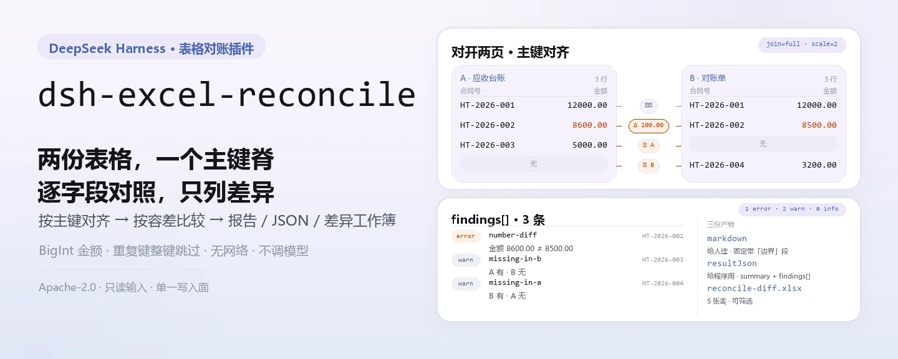
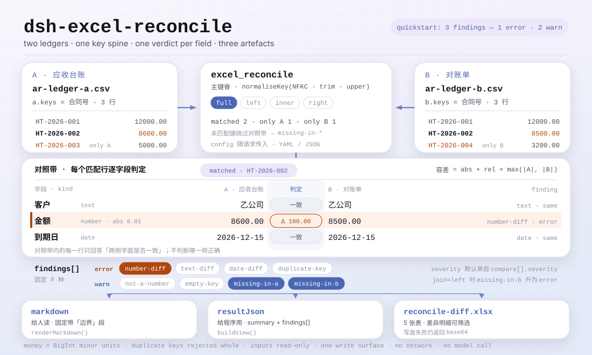

<div align="center">

<picture>
  <source media="(prefers-color-scheme: dark)" srcset="docs/assets/dsh-excel-reconcile-hero-zh-dark.webp">
  
</picture>

# dsh-excel-reconcile

**把两份 Excel/CSV 按主键对齐，逐字段告诉你哪里不一致——只列差异，不替人裁决。**

面向 DeepSeek Harness 的对账插件：按声明的主键连接两份表格，按声明的字段与容差逐项比较，输出 Markdown 报告、JSON 结果与差异工作簿；金额用整数最小单位比较，主键重复时整键跳过而不是随手配对。

[安装](#三步上手) · [配置](#配置) · [FAQ](#faq) · [简体中文](README.md) · [English](README.en.md)

[](LICENSE)
[](#兼容性)
[](https://www.npmjs.com/package/dsh-excel-reconcile)
[](https://github.com/PerryLink/dsh-excel-reconcile/actions/workflows/ci.yml)
[](#兼容性)

[](https://github.com/PerryLink/dsh-excel-reconcile/stargazers)
[](https://www.npmjs.com/package/dsh-excel-reconcile)
[](https://dshfind.com/en/plugins/PerryLink/dsh-excel-reconcile?ref=badge)
[](https://securityscorecards.dev/viewer/?uri=github.com/PerryLink/dsh-excel-reconcile)

```sh
dsh plugin --profile <name> add dsh-excel-reconcile
```

</div>

<sub>社区插件，与 DeepSeek 官方无关。唯一仓库：<https://github.com/PerryLink/dsh-excel-reconcile>。</sub>

## 它是什么

`dsh-excel-reconcile` 把两份表格（`.xlsx` / `.xlsm` / `.csv` / `.docx` 表格）按配置的主键对齐，逐字段比较，输出三样东西：给人读的 Markdown 报告、给程序用的 JSON 结果、给经办人筛选的差异工作簿（5 张表）。每次调用只做一次对账：主键、比较字段、连接方式、容差都随请求的 YAML/JSON 配置传入，不随包发布固定规则。

它对账，不裁决：出现差异说明两侧不一致，不说明哪一侧错了。金额按整数最小单位（BigInt）比较而非浮点，所以 `12.3` 与 `12.30000000001` 在两位小数下是同一笔；主键重复时报 `duplicate-key` 并整键跳过，不做任意配对——配第一条会把真正重要的差异藏起来。纯 ESM：无网络请求，无模型调用。

<picture>
  <source media="(prefers-color-scheme: dark)" srcset="docs/assets/dsh-excel-reconcile-flow-v5-dark.svg">
  
</picture>

## 三步上手

1. **安装**：

   ```sh
   dsh plugin --profile <name> add dsh-excel-reconcile
   dsh --profile <name> --dump-config | grep 'dsh-excel-reconcile'
   ```

   插件以 bundle patch 行注册（`cordis.patch.yml` 只 `insert` 自己一行）；装好后工具名是 `excel_reconcile`。

2. **最小配置**（profile patch，三个键都可省略）：

   ```yaml
   - insert:
       - id: dsh-excel-reconcile
         name: dsh-excel-reconcile
         config:
           timeoutMs: 120000
           scale: 2
           diffWorkbook: reconcile-diff.xlsx
   ```

3. **验证已生效**：在会话里让模型调用 `excel_reconcile`，或在仓库检出目录跑自带样例（首次需 `pnpm install && pnpm run build`，样例从 `lib/index.mjs` 载入）：

   ```sh
   node samples/quickstart/run.mjs --check
   ```

   ```
   $ node samples/quickstart/run.mjs
   excel_reconcile: 3 finding(s) — 1 error, 2 warn, 0 info
   rows: A=3 B=3, matched 2, only A=1, only B=1, duplicate keys=0
   ```

   *Observed from `docs/assets/quickstart.log`；期望值见 `samples/quickstart/expected/result.json`*

**卸载**：`dsh plugin --profile <name> remove dsh-excel-reconcile`（或从 profile patch 删掉该行）。

## 核心能力

- **按主键对齐（四向连接）** —— `join` 取 `full`（默认，两侧都保留）、`left`、`inner`、`right`；`a.keys` 与 `b.keys` 按位置对应，数量不一致直接报错。
- **逐字段比较，容差可声明** —— `compare[]` 每项声明 `a`（及可选 `b`）、`kind`（`number`/`text`/`date`）、`abs`/`rel`、`severity`、`label`；数字容差按 `abs + rel × max(|A|, |B|)` 计算。
- **差异有类型** —— `number-diff`、`text-diff`、`date-diff`、`not-a-number`、`missing-in-a`、`missing-in-b`、`duplicate-key`、`empty-key`；每条带主键、字段、两侧值、差值、说明与建议处理。
- **三份产物，一份数据** —— Markdown 报告给人读，`resultJson` 给程序用，差异工作簿给经办人筛选；工作簿写盘失败时字节仍以 `workbookBase64` 返回，不会静默丢结果。
- **金额不碰浮点** —— 金额按 `scale`（默认 2）转成 BigInt 最小单位再比，`12.3` 与 `12.30000000001` 视为同一笔。
- **不猜** —— 主键重复整键跳过；空主键报 `empty-key`；某侧 0 行写进 `warnings`；缺主键列报错，缺比较列则每行如实报差异，而不是静默补空。

### 它能回答什么

- 哪些主键只有一侧有？
- 哪些匹配上的行不一致、不一致在哪个字段、差多少？
- 这个差是否超出我配置的容差？
- 哪些主键因为重复而根本无法比较？

### 产物长什么样

对账配置（随请求传入，YAML 或 JSON 文本）：

```yaml
a: { table: 应收, keys: [合同号] }
b: { table: 对账单, keys: [合同号] }
join: full
compare:
  - { a: 客户, kind: text }
  - { a: 金额, kind: number, abs: 0.01 }
  - { a: 到期日, kind: date }
```

差异工作簿 5 张表：

```text
汇总, 差异明细, 仅A存在, 仅B存在, 合并结果
```

`差异明细` 一行一条差异、冻结前 3 列、列顺序固定：

```text
序号, 问题类型, 严重程度, 主键, 字段, A 侧, B 侧, 差异, 说明, 建议处理, 处理状态
```

## 配置

所有可调项都是 Schemastery `Config` 字段（可从 cordis.yml 覆盖）。按 id 覆盖会替换整行——请重述所有需要的键。

| 键 | 默认值 | 含义 |
|---|---|---|
| `timeoutMs` | `120000` | 工具超时预算（毫秒），透传给 `defineTool` |
| `scale` | `2` | 金额比较使用的小数位数；也用于容差换算 |
| `diffWorkbook` | `reconcile-diff.xlsx` | 差异工作簿输出文件名（相对宿主进程 cwd）；置空则只返回 base64，不落盘 |

> 旧文档里的 `rulesFile` 不是本插件的配置键：`rules/excel-reconcile.yaml` 是规则库占位（`rules: []`），每份对账的规则随请求配置传入；Schema 只有上表三个键。

<details>
<summary>对账配置（随请求传入，不是插件配置）</summary>

| 字段 | 含义 |
|---|---|
| `a.table`、`a.keys` | A 侧表名与主键字段 |
| `b.table`、`b.keys` | B 侧表名与主键字段（与 A 按位置对应） |
| `join` | `full`（默认）、`left`、`inner`、`right` |
| `compare[]` | 要比较的字段：`a`、`b`、`kind`（`number`/`text`/`date`）、`abs`、`rel`、`severity`、`label` |
| `duplicates` | `reject`（默认）报告并跳过；`aggregate` 为预留值（见已知限制） |
| `scale` | 金额小数位，默认 2 |

</details>

## FAQ

<details>
<summary>会改动我的原表吗？结果写到哪里？</summary>

不会。两份输入只用 `readFile` 读入后交给 `dsh-table-ingest` 解析，插件不写回原文件。唯一的写盘是差异工作簿：写到工具参数 `outFile`，没给就用 `diffWorkbook`（默认 `reconcile-diff.xlsx`，相对宿主进程 cwd）；写不进去（例如只读沙箱）时字节仍以 base64 返回。全程无网络请求、无模型调用。

</details>

<details>
<summary>主键重复时为什么整键不比较？</summary>

重复的主键可能对应多行，配第一条会把真正重要的差异藏起来，所以默认报一条 `duplicate-key`（error）并整键跳过。`duplicates: aggregate` 是预留值：当前版本未实现聚合，设为 `aggregate` 时不报重复、仍取该主键第一行参与比较——一对多场景请先自行聚合或在配置里拆键。

</details>

<details>
<summary>金额会被舍入吗？容差怎么算？</summary>

金额先按 `scale` 转成整数最小单位再比较，超出 `scale` 的小数位被截断（不是四舍五入）：`12.345` 在 `scale: 2` 下按 `12.34` 比较。数字字段的容差是 `abs + rel × max(|A|, |B|)`，默认 `abs`/`rel` 都是 0，即要求完全相等；容差是配置，不是法规。

</details>

<details>
<summary>某一侧缺行、缺列或主键为空会怎样？</summary>

缺行由 `join` 决定：`full`/`left` 把「只在 A」报成 `missing-in-b`，`full`/`right` 把「只在 B」报成 `missing-in-a`；`inner` 两侧都不报。某一侧缺列时，每个匹配行都会在该字段上报差异，而不是跳过——这是刻意的，漏列不会被当成一致。主键列为空的行报 `empty-key` 并跳过；表名、主键列名或主键数量对不上时直接抛 `ReconcileError`。

</details>

<details>
<summary>装了插件但工具没出现，或 `dsh plugin add` 拒绝安装？</summary>

先确认 `main` 指向 `lib/index.mjs` 且 `pnpm run build` 真的产出了它；这个包发布的是构建产物 `lib/`。安装被拒通常是对等范围问题：`@deepseek-ai/dsh-tools` 的 peer 范围覆盖 `0.1.x` 与 `0.2.x`，宿主在范围外时需要显式豁免。工具调用报「对账配置无法解析」时，先看 YAML 缩进与 `a.table`/`b.table` 是否齐全。

</details>

## 安全边界

- **只读输入，单一写入面。** 两份输入只读，插件不写回；唯一隐式写盘是 `diffWorkbook` 指向的差异工作簿，显式写盘是工具参数 `outFile`。
- **不判合规、不裁决。** 差异不等于错误：报告固定带「边界」段，写明只报告字面差异、不判断哪侧正确、容差是配置不是法规；`suggestion` 只给下一步核对建议。
- **失败关闭、报错要响。** 配置解析失败、缺 `a.table`/`b.table`、表名不存在、主键数量不一致、主键列不存在、文件抽不出表格——全部抛 `ReconcileError`，不猜、不静默产出「无差异」。
- **无网络、无模型调用。** 纯 ESM，`dsh-table-ingest` 本地解析 OOXML/CSV；不读凭据、不发请求。
- **写盘失败不降级为静默成功。** 工作簿写不进去时 `workbookPath` 为空，但 `workbookBase64` 仍返回完整字节，调用方可以自行落盘。
- **注册即 effect。** `apply` 直接返回 `ctx.tools.register(...)` 的 disposer，停止或热重载即注销工具。

## 已知限制

- **连接只有一层。** 不做链式 join（A↔B↔C）；多表对账请拆成多次调用。
- **重复主键永不配对。** `duplicates: aggregate` 尚未实现聚合，设为 `aggregate` 时不报 `duplicate-key`、仍取该主键第一行参与比较（见 FAQ 第二条）。
- **金额按配置小数位截断。** 超过 `scale` 的位数先截断再比；需要更高精度就调大 `scale`，别指望本工具替你做四舍五入。
- **缺列会放大差异。** 某一侧缺列时每个匹配行都报差异，而不是跳过。
- **不编码任何条款。** 对账的 schema 是自己的：主键、比较字段、连接方式、容差、严重度。这是刻意的——对账没有可引用的规范性依据，编一个会让报告显得比实际更权威。
- **没有取证目录。** 规则库按设计为空（`rules/excel-reconcile.yaml` 里 `rules: []`），每份对账自带配置；`pnpm run check:citations` 期望 0 segments / 0 placeholders / 0 untraceable。
- **依赖 OOXML 部件。** `sharedStrings.xml`、`cellXfs`/`numFmtId`、`workbook.xml` 与 `_rels` 由 `dsh-table-ingest` 读取；抽不出表时抛错并给出候选表数量。
- **无 UI。** 纯 host 工具，没有客户端半；所有交互都经 `excel_reconcile` 工具调用。
- **空主键不按位置配对。** 主键为空的行只报 `empty-key`，不会猜它对应另一侧的哪一行。

## 与其他 DSH 插件的互操作性

- **只注入 `tools` 服务**（`inject = ['tools']`），不依赖也不提供其他服务键。
- **只注册一个工具。** `excel_reconcile` 由 `TOOL_NAME` 常量导出；不注册命令、客户端 slot 或 `webServer` 路由，因此不参与 slot 与 HTTP 前缀争抢。
- **不订阅共享事件。** 不使用 `ctx.on()`，不参与 `agent/pre-step`、`tools/post-execute` 等事件链的先后顺序，也不会短路别人的链。
- **patch 层只 `insert` 自己一行**，从不覆写内置行的 `config`。
- **无全局改写。** 不改原型、不写 `process.env`、不替换全局 fetch。
- **注册即 effect。** 见「安全边界」最后一条。

## 兼容性

| 维度 | 状态 |
|---|---|
| Harness | `engines.dsh` 为 `>=0.2.1-0 <0.3.0`；对 `@deepseek-ai/dsh-tools` 的 peer 范围为 `>=0.1.2-rc.1 <0.2.0 \|\| >=0.2.0-0 <0.3.0` |
| Node | `^22.19.0 \|\| >=24.0.0` |
| 平台 | 任何 DSH 可运行处（纯 ESM；无原生代码、无网络、无模型调用） |
| 输入 | `.xlsx` / `.xlsm` / `.csv` / `.docx` 表格 |
| 模型 | 文本模型完全支持；工具结果是 Markdown 文本，不需要额外模型能力 |

## 生态与质量

- [dshfind 插件页](https://dshfind.com/en/plugins/PerryLink/dsh-excel-reconcile)（安装量与排名）
- [OpenSSF Scorecard 报告](https://securityscorecards.dev/viewer/?uri=github.com/PerryLink/dsh-excel-reconcile)（由 [.github/workflows/scorecard.yml](.github/workflows/scorecard.yml) 驱动）
- [PerryLink 插件家族](https://github.com/PerryLink)（全部 Apache-2.0）
- [生态知识库](https://perrylink.github.io/dsh-plugin-guide/)：插件开发指南 · 选型实测数据 · 维护取舍判据

## 开发

```sh
pnpm install
pnpm run typecheck
pnpm test
pnpm run build
pnpm run verify:self-contained
pnpm run check:lockfile
pnpm run check:readmes
pnpm run check:citations
node samples/quickstart/run.mjs --check
node ../scripts/sync-shared.mjs dsh-excel-reconcile
```

本仓不发布 benchmark 数据，因此没有「实测数据」章节，也不画证据图。配图由 [`scripts/gen-readme-assets.py`](scripts/gen-readme-assets.py) 程序化生成（Python + Pillow）：输出 `docs/assets/dsh-excel-reconcile-hero-{zh,en}-{light,dark}.webp` 四张中英横幅与 `docs/assets/dsh-excel-reconcile-flow-v5-{light,dark}.svg` 两张结构图，可重复执行，图内只放命令 token、样例键与短标注，五语共用同一对结构图。终端记录见 [docs/assets/quickstart.png](docs/assets/quickstart.png) 与 [docs/assets/quickstart.log](docs/assets/quickstart.log)。

Topics：`dsh`, `dsh-plugin`, `deepseek-harness`, `deepseek`, `cordis`, `reconcile`, `excel`, `csv`, `diff`, `join`

## 家族与致谢

本项目是 [PerryLink](https://github.com/PerryLink) 维护的 DeepSeek Harness 插件家族成员（全部 Apache-2.0）。如果这个插件帮到了你，**给个 star**——它不解锁任何功能，但会让下一个人更容易找到它。

- [@PerryLink](https://github.com/PerryLink) —— 创建者与维护者：对账模型（BigInt 金额、四向连接、重复键策略）、差异工作簿、`excel_reconcile` 工具与五语文档。

<details>
<summary>展开全部插件</summary>

| 插件 | 状态 |
|---|---|
| **[dsh-aqua-input-check](https://github.com/PerryLink/dsh-aqua-input-check)** |  |
| **[dsh-archive-check](https://github.com/PerryLink/dsh-archive-check)** |  |
| **[dsh-auto-review](https://github.com/PerryLink/dsh-auto-review)** |  |
| **[dsh-autotier](https://github.com/PerryLink/dsh-autotier)** | 🧊 已冻结 — 见仓库 README |
| **[dsh-bid-ca-precheck](https://github.com/PerryLink/dsh-bid-ca-precheck)** |  |
| **[dsh-bid-qual-check](https://github.com/PerryLink/dsh-bid-qual-check)** |  |
| **[dsh-cert-mcp](https://github.com/PerryLink/dsh-cert-mcp)** | 🧊 已冻结 — 见仓库 README |
| **[dsh-checkpoint-rewind](https://github.com/PerryLink/dsh-checkpoint-rewind)** |  |
| **[dsh-click](https://github.com/PerryLink/dsh-click)** |  |
| **[dsh-composer-history](https://github.com/PerryLink/dsh-composer-history)** |  |
| **[dsh-contract-stance](https://github.com/PerryLink/dsh-contract-stance)** |  |
| **[dsh-customs-doc-check](https://github.com/PerryLink/dsh-customs-doc-check)** |  |
| **[dsh-data-quality](https://github.com/PerryLink/dsh-data-quality)** | 🧊 已冻结 — 见仓库 README |
| **[dsh-demurrage-ledger](https://github.com/PerryLink/dsh-demurrage-ledger)** |  |
| **[dsh-doublecheck](https://github.com/PerryLink/dsh-doublecheck)** |  |
| **[dsh-drill-script-check](https://github.com/PerryLink/dsh-drill-script-check)** |  |
| **[dsh-eia-guide-check](https://github.com/PerryLink/dsh-eia-guide-check)** |  |
| **[dsh-emergency-plan](https://github.com/PerryLink/dsh-emergency-plan)** |  |
| **[dsh-essay-rubric-check](https://github.com/PerryLink/dsh-essay-rubric-check)** |  |
| **[dsh-evidence-check](https://github.com/PerryLink/dsh-evidence-check)** |  |
| **[dsh-export-ctl-check](https://github.com/PerryLink/dsh-export-ctl-check)** |  |
| **[dsh-fast](https://github.com/PerryLink/dsh-fast)** |  |
| **[dsh-fmea-table-check](https://github.com/PerryLink/dsh-fmea-table-check)** |  |
| **[dsh-forecast-penalty](https://github.com/PerryLink/dsh-forecast-penalty)** |  |
| **[dsh-fund-research](https://github.com/PerryLink/dsh-fund-research)** |  |
| **[dsh-github](https://github.com/PerryLink/dsh-github)** |  |
| **[dsh-gongwen-flow-check](https://github.com/PerryLink/dsh-gongwen-flow-check)** |  |
| **[dsh-gongwen-word-check](https://github.com/PerryLink/dsh-gongwen-word-check)** |  |
| **[dsh-guard-plan-qc](https://github.com/PerryLink/dsh-guard-plan-qc)** |  |
| **[dsh-hazchem-check](https://github.com/PerryLink/dsh-hazchem-check)** |  |
| **[dsh-hazplan-check](https://github.com/PerryLink/dsh-hazplan-check)** |  |
| **[dsh-hidden-risk-map](https://github.com/PerryLink/dsh-hidden-risk-map)** |  |
| **[dsh-hs-classify](https://github.com/PerryLink/dsh-hs-classify)** |  |
| **[dsh-icd-rule-check](https://github.com/PerryLink/dsh-icd-rule-check)** |  |
| **[dsh-industry-research](https://github.com/PerryLink/dsh-industry-research)** |  |
| **[dsh-lawcite-adapter](https://github.com/PerryLink/dsh-lawcite-adapter)** |  |
| **[dsh-laya](https://github.com/PerryLink/dsh-laya)** |  |
| **[dsh-lc-doc-check](https://github.com/PerryLink/dsh-lc-doc-check)** |  |
| **[dsh-learning-gap-check](https://github.com/PerryLink/dsh-learning-gap-check)** |  |
| **[dsh-library](https://github.com/PerryLink/dsh-library)** |  |
| **[dsh-local-ai](https://github.com/PerryLink/dsh-local-ai)** |  |
| **[dsh-lsp-actions](https://github.com/PerryLink/dsh-lsp-actions)** |  |
| **[dsh-mask](https://github.com/PerryLink/dsh-mask)** |  |
| **[dsh-mcp-panel](https://github.com/PerryLink/dsh-mcp-panel)** |  |
| **[dsh-medrec-qc](https://github.com/PerryLink/dsh-medrec-qc)** |  |
| **[dsh-memento](https://github.com/PerryLink/dsh-memento)** | 🧊 已冻结 — 见仓库 README |
| **[dsh-nsfc-form-check](https://github.com/PerryLink/dsh-nsfc-form-check)** |  |
| **[dsh-nurse-record-check](https://github.com/PerryLink/dsh-nurse-record-check)** |  |
| **[dsh-observe](https://github.com/PerryLink/dsh-observe)** |  |
| **[dsh-origin-rvc-check](https://github.com/PerryLink/dsh-origin-rvc-check)** |  |
| **[dsh-ota-review-check](https://github.com/PerryLink/dsh-ota-review-check)** |  |
| **[dsh-output-styles](https://github.com/PerryLink/dsh-output-styles)** |  |
| **[dsh-paper-doc-adapter](https://github.com/PerryLink/dsh-paper-doc-adapter)** |  |
| **[dsh-permission-rules](https://github.com/PerryLink/dsh-permission-rules)** |  |
| **[dsh-permit-report-check](https://github.com/PerryLink/dsh-permit-report-check)** |  |
| **[dsh-pipeline-check](https://github.com/PerryLink/dsh-pipeline-check)** |  |
| **[dsh-pleading-draft](https://github.com/PerryLink/dsh-pleading-draft)** |  |
| **[dsh-plugin-doctor](https://github.com/PerryLink/dsh-plugin-doctor)** | 🚫 已退役（仓库已归档） |
| **[dsh-plugin-guide](https://github.com/PerryLink/dsh-plugin-guide)** |  |
| **[dsh-plugin-kit](https://github.com/PerryLink/dsh-plugin-kit)** | 🚫 已退役（仓库已归档） |
| **[dsh-plugin-upgrade](https://github.com/PerryLink/dsh-plugin-upgrade)** | 🚫 已退役（仓库已归档） |
| **[dsh-policy-brief-draft](https://github.com/PerryLink/dsh-policy-brief-draft)** |  |
| **[dsh-power-loss-split](https://github.com/PerryLink/dsh-power-loss-split)** |  |
| **[dsh-power-ticket-check](https://github.com/PerryLink/dsh-power-ticket-check)** |  |
| **[dsh-ppap-check](https://github.com/PerryLink/dsh-ppap-check)** |  |
| **[dsh-protest-deadline](https://github.com/PerryLink/dsh-protest-deadline)** |  |
| **[dsh-railway-window](https://github.com/PerryLink/dsh-railway-window)** |  |
| **[dsh-repair-order-qc](https://github.com/PerryLink/dsh-repair-order-qc)** |  |
| **[dsh-research-report](https://github.com/PerryLink/dsh-research-report)** |  |
| **[dsh-review-reply-check](https://github.com/PerryLink/dsh-review-reply-check)** |  |
| **[dsh-rulefile-check](https://github.com/PerryLink/dsh-rulefile-check)** |  |
| **[dsh-safety-brief-check](https://github.com/PerryLink/dsh-safety-brief-check)** |  |
| **[dsh-score](https://github.com/PerryLink/dsh-score)** | 🧊 已冻结 — 见仓库 README |
| **[dsh-session-sync](https://github.com/PerryLink/dsh-session-sync)** |  |
| **[dsh-site-log-check](https://github.com/PerryLink/dsh-site-log-check)** |  |
| **[dsh-skill-pack-security](https://github.com/PerryLink/dsh-skill-pack-security)** |  |
| **[dsh-soe-decision-check](https://github.com/PerryLink/dsh-soe-decision-check)** |  |
| **[dsh-soilwater-check](https://github.com/PerryLink/dsh-soilwater-check)** |  |
| **[dsh-sop-sync-check](https://github.com/PerryLink/dsh-sop-sync-check)** |  |
| **[dsh-spc-gbt-adapter](https://github.com/PerryLink/dsh-spc-gbt-adapter)** |  |
| **[dsh-talk](https://github.com/PerryLink/dsh-talk)** |  |
| **[dsh-tender-extract](https://github.com/PerryLink/dsh-tender-extract)** |  |
| **[dsh-tender-matrix](https://github.com/PerryLink/dsh-tender-matrix)** |  |
| **[dsh-test-drive](https://github.com/PerryLink/dsh-test-drive)** |  |
| **[dsh-ticktick](https://github.com/PerryLink/dsh-ticktick)** | 🚫 已退役（仓库已归档） |
| **[dsh-translate](https://github.com/PerryLink/dsh-translate)** |  |
| **[dsh-warranty-calc](https://github.com/PerryLink/dsh-warranty-calc)** |  |
| **[dsh-budget](https://github.com/PerryLink/dsh-budget)** | 🧊 已冻结 — 见仓库 README |
| **[dsh-claude-move](https://github.com/PerryLink/dsh-claude-move)** | 🧊 已冻结 — 见仓库 README |
| **[dsh-defend](https://github.com/PerryLink/dsh-defend)** | 🧊 已冻结 — 见仓库 README |
| **[dsh-draw](https://github.com/PerryLink/dsh-draw)** | 🧊 已冻结 — 见仓库 README |
| **[dsh-reach](https://github.com/PerryLink/dsh-reach)** | 🧊 已冻结 — 见仓库 README |
| **[dsh-background-agents](https://github.com/PerryLink/dsh-background-agents)** | 🚫 已退役（仓库已归档） |
| **[dsh-session-pin](https://github.com/PerryLink/dsh-session-pin)** | 🚫 已退役（仓库已归档） |
| **[dsh-team-rooms](https://github.com/PerryLink/dsh-team-rooms)** | 🚫 已退役（仓库已归档） |

</details>

## License

[LICENSE](LICENSE)（Apache License 2.0）© 2026 dsh-excel-reconcile contributors

<p align="center"><sub>Apache-2.0 · 社区插件，与 DeepSeek 无关。</sub></p>
