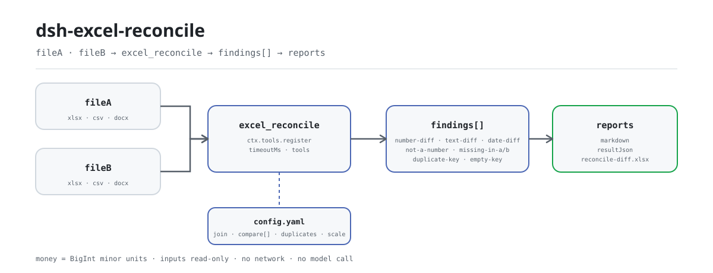

<div align="center">

<picture>
  <source media="(prefers-color-scheme: dark)" srcset="docs/assets/dsh-excel-reconcile-flow-dark.svg">
  
</picture>

# dsh-excel-reconcile

**Alinhe duas tabelas Excel/CSV por uma chave e receba cada campo divergente — apenas diferenças, sem julgamento.**

Um plugin de conciliação para o DeepSeek Harness: une duas tabelas por chaves declaradas, compara campos declarados com tolerâncias declaradas e produz um relatório Markdown, um resultado JSON e uma pasta de trabalho de diferenças; o dinheiro é comparado em unidades menores inteiras e uma chave duplicada é ignorada por inteiro em vez de emparelhada arbitrariamente.

[Instalar](#instalação-em-três-passos) · [Configuração](#configuração) · [FAQ](#faq) · [简体中文](README.md) · [English](README.en.md) · [Español](README.es.md) · [Português](README.pt.md) · [हिन्दी](README.hi.md)

[](LICENSE)
[](#compatibilidade)
[](https://www.npmjs.com/package/dsh-excel-reconcile)
[](https://github.com/PerryLink/dsh-excel-reconcile/actions/workflows/ci.yml)
[](#compatibilidade)

[](https://github.com/PerryLink/dsh-excel-reconcile/stargazers)
[](https://www.npmjs.com/package/dsh-excel-reconcile)
[](https://dshfind.com/en/plugins/PerryLink/dsh-excel-reconcile?ref=badge)
[](https://securityscorecards.dev/viewer/?uri=github.com/PerryLink/dsh-excel-reconcile)

```sh
dsh plugin --profile <name> add dsh-excel-reconcile
```

</div>

<sub>Plugin da comunidade, sem afiliação com a DeepSeek. Repositório canônico: <https://github.com/PerryLink/dsh-excel-reconcile>.</sub>

## O que é

O `dsh-excel-reconcile` alinha duas tabelas (`.xlsx` / `.xlsm` / `.csv` / tabelas `.docx`) pelas chaves configuradas, compara campo a campo e produz três artefatos: um relatório Markdown para pessoas, um resultado JSON para programas e uma pasta de trabalho de diferenças (cinco planilhas) para quem revisa. Cada chamada faz exatamente uma conciliação: chaves, campos comparados, modo de junção e tolerâncias viajam com a requisição como YAML/JSON; o pacote não traz um conjunto de regras fixo.

Concilia, não julga: uma diferença significa que os dois lados não coincidem, não que um esteja errado. O dinheiro é comparado em unidades menores inteiras (BigInt), nunca em ponto flutuante, então `12.3` e `12.30000000001` são o mesmo valor com duas casas; uma chave que aparece duas vezes é reportada como `duplicate-key` e ignorada por inteiro em vez de emparelhada arbitrariamente, porque emparelhar a primeira ocorrência esconde a diferença que importa. ESM puro: sem requisições de rede e sem chamadas ao modelo.

## Instalação em três passos

1. **Instale**:

   ```sh
   dsh plugin --profile <name> add dsh-excel-reconcile
   dsh --profile <name> --dump-config | grep 'dsh-excel-reconcile'
   ```

   O plugin é registrado como uma linha do patch do bundle (`cordis.patch.yml` apenas faz `insert` da própria linha); a ferramenta exposta chama-se `excel_reconcile`.

2. **Configuração mínima** (patch do perfil; as três chaves são opcionais):

   ```yaml
   - insert:
       - id: dsh-excel-reconcile
         name: dsh-excel-reconcile
         config:
           timeoutMs: 120000
           scale: 2
           diffWorkbook: reconcile-diff.xlsx
   ```

3. **Verifique que montou**: peça ao modelo para chamar `excel_reconcile` numa sessão, ou rode o exemplo incluído a partir de um checkout (antes `pnpm install && pnpm run build`; o exemplo carrega `lib/index.mjs`):

   ```sh
   node samples/quickstart/run.mjs --check
   ```

   ```
   $ node samples/quickstart/run.mjs
   excel_reconcile: 3 finding(s) — 1 error, 2 warn, 0 info
   rows: A=3 B=3, matched 2, only A=1, only B=1, duplicate keys=0
   ```

   *Observed from `docs/assets/quickstart.log`; os valores esperados estão em `samples/quickstart/expected/result.json`*

**Desinstalar**: `dsh plugin --profile <name> remove dsh-excel-reconcile` (ou remova a linha do patch do perfil).

## Capacidades principais

- **Alinhamento por chave (quatro modos de junção)** — `join` é `full` (padrão, preserva os dois lados), `left`, `inner` ou `right`; `a.keys` e `b.keys` se correspondem por posição e um comprimento diferente falha em voz alta.
- **Comparação campo a campo com tolerâncias declaradas** — cada entrada de `compare[]` declara `a` (e opcionalmente `b`), `kind` (`number`/`text`/`date`), `abs`/`rel`, `severity` e `label`; a margem numérica é `abs + rel × max(|A|, |B|)`.
- **Diferenças tipadas** — `number-diff`, `text-diff`, `date-diff`, `not-a-number`, `missing-in-a`, `missing-in-b`, `duplicate-key` e `empty-key`; todo achado leva chave, campo, os dois valores, delta, explicação e próximo passo sugerido.
- **Três artefatos de uma passada** — o relatório Markdown é para ler, `resultJson` para programas e a pasta de trabalho para filtrar; se o arquivo não puder ser escrito, os bytes ainda voltam em `workbookBase64`, então um sandbox somente leitura nunca perde o resultado em silêncio.
- **O dinheiro nunca passa por ponto flutuante** — os valores são convertidos em unidades menores BigInt com `scale` (2 por padrão) antes de comparar, então `12.3` e `12.30000000001` são o mesmo valor.
- **Não adivinha** — uma chave duplicada é ignorada por inteiro; uma chave vazia reporta `empty-key`; um lado vazio é anotado em `warnings`; uma coluna-chave ausente falha em voz alta, e uma coluna comparada ausente é reportada linha a linha em vez de ser preenchida com brancos.

### O que ele responde

- Quais chaves existem em um lado e não no outro?
- Quais linhas emparelhadas divergem, em qual campo e quanto?
- A divergência excede a tolerância que configurei?
- Quais chaves não podem ser comparadas por estarem duplicadas?

### Como é a saída

A configuração de conciliação viaja com a requisição (texto YAML ou JSON):

```yaml
a: { table: 应收, keys: [合同号] }
b: { table: 对账单, keys: [合同号] }
join: full
compare:
  - { a: 客户, kind: text }
  - { a: 金额, kind: number, abs: 0.01 }
  - { a: 到期日, kind: date }
```

A pasta de trabalho de diferenças tem cinco planilhas (os nomes fazem parte do artefato):

```text
汇总, 差异明细, 仅A存在, 仅B存在, 合并结果
```

`差异明细` guarda uma linha por diferença, congela as 3 primeiras colunas e tem ordem de colunas fixa:

```text
序号, 问题类型, 严重程度, 主键, 字段, A 侧, B 侧, 差异, 说明, 建议处理, 处理状态
```

## Configuração

Todas as opções são campos Schemastery `Config` (sobrescrevíveis via cordis.yml). Uma sobrescrita por id substitui a linha inteira — repita todas as chaves de que precisar.

| Chave | Padrão | Significado |
|---|---|---|
| `timeoutMs` | `120000` | Orçamento de timeout da ferramenta em milissegundos, repassado ao `defineTool` |
| `scale` | `2` | Casas decimais para comparar dinheiro; também é usado para converter tolerâncias |
| `diffWorkbook` | `reconcile-diff.xlsx` | Nome do arquivo da pasta de diferenças (relativo ao cwd do processo host); vazio devolve só base64 e não grava |

> A documentação antiga listava `rulesFile`; essa não é uma chave de configuração deste plugin. `rules/excel-reconcile.yaml` é um marcador do conjunto de regras (`rules: []`), e cada conciliação leva a própria configuração com a requisição. O schema tem exatamente as três chaves acima.

<details>
<summary>Configuração de conciliação (viaja com a requisição, não é configuração do plugin)</summary>

| Campo | Significado |
|---|---|
| `a.table`, `a.keys` | Nome da tabela e campos-chave do lado A |
| `b.table`, `b.keys` | Nome da tabela e campos-chave do lado B, alinhados por posição com A |
| `join` | `full` (padrão), `left`, `inner`, `right` |
| `compare[]` | Campos a comparar: `a`, `b`, `kind` (`number`/`text`/`date`), `abs`, `rel`, `severity`, `label` |
| `duplicates` | `reject` (padrão) reporta e ignora; `aggregate` é reservado (ver Limitações conhecidas) |
| `scale` | Casas decimais para dinheiro, 2 por padrão |

</details>

## FAQ

<details>
<summary>Ele modifica meus arquivos de origem? Para onde vai a saída?</summary>

Não. As duas entradas são lidas com `readFile` e interpretadas pelo `dsh-table-ingest`; o plugin nunca as reescreve. A única gravação implícita é a pasta de diferenças no caminho `diffWorkbook` (padrão `reconcile-diff.xlsx`, relativo ao cwd do processo host); o argumento explícito `outFile` da ferramenta o substitui. Se o volume for somente leitura, os bytes ainda voltam em base64. Não há requisições de rede nem chamadas ao modelo em nenhum ponto.

</details>

<details>
<summary>Por que uma chave duplicada é ignorada em vez de comparada?</summary>

Uma chave duplicada pode corresponder a várias linhas e emparelhar a primeira esconde a diferença que importa, então o padrão reporta um achado `duplicate-key` (error) e ignora a chave inteira. `duplicates: aggregate` é reservado: a versão atual não agrega — com `aggregate` ele deixa de reportar duplicados mas continua comparando a primeira linha dessa chave. Para trabalhar um-para-muitos, agregue ou divida a chave antes.

</details>

<details>
<summary>Os valores são arredondados? Como a tolerância é calculada?</summary>

Os valores são convertidos em unidades menores inteiras com `scale` antes de comparar, e os dígitos além de `scale` são truncados, não arredondados: `12.345` é comparado como `12.34` com `scale: 2`. A margem numérica é `abs + rel × max(|A|, |B|)`; ambos valem 0 por padrão, o que exige igualdade exata. Tolerâncias são configuração, não norma.

</details>

<details>
<summary>O que acontece com uma linha ausente, uma coluna ausente ou uma chave vazia?</summary>

Uma linha ausente é decidida pelo `join`: `full`/`left` reportam «só A» como `missing-in-b`, `full`/`right` reportam «só B» como `missing-in-a`, e `inner` não reporta nenhum. Quando falta uma coluna em um lado, cada linha emparelhada reporta uma diferença nesse campo em vez de ignorá-la — de propósito, porque uma coluna perdida não deve ser lida como concordância. Uma linha com chave vazia reporta `empty-key` e é ignorada; uma tabela ausente, uma coluna-chave ausente ou um número de chaves diferente lançam `ReconcileError`.

</details>

<details>
<summary>A ferramenta não aparece, ou o `dsh plugin add` rejeita o pacote?</summary>

Primeiro confirme que `main` resolve para `lib/index.mjs` e que o `pnpm run build` realmente o gerou; este pacote publica o `lib/` compilado. Uma rejeição de instalação costuma ser questão de faixa de peer: a faixa de `@deepseek-ai/dsh-tools` cobre `0.1.x` e `0.2.x`, então um host fora dela precisa de isenção explícita. Se uma chamada disser que a configuração de conciliação não pode ser interpretada, verifique a indentação YAML e se `a.table`/`b.table` estão presentes.

</details>

## Limites de segurança

- **Entradas somente leitura, uma única superfície de gravação.** As duas entradas apenas são lidas; o plugin nunca as reescreve. A única gravação implícita é a pasta de diferenças em `diffWorkbook`; a gravação explícita é o argumento `outFile` da ferramenta.
- **Sem veredito de conformidade, sem julgamento.** Uma diferença não é um erro: o relatório sempre traz uma seção de «limite» dizendo que lista apenas diferenças literais, que não decide qual lado está certo e que tolerâncias são configuração, não norma; `suggestion` apenas propõe a próxima verificação.
- **Falha fechada e em voz alta.** Uma configuração que não pode ser interpretada, um `a.table`/`b.table` ausente, um nome de tabela desconhecido, um número de chaves diferente, uma coluna-chave ausente ou um arquivo do qual não se extrai uma tabela lançam `ReconcileError`: nada é adivinhado e nenhum «sem diferenças» silencioso é produzido.
- **Sem rede, sem chamadas ao modelo.** ESM puro; o `dsh-table-ingest` interpreta OOXML/CSV localmente. Nenhuma credencial é lida e nenhuma requisição é feita.
- **Uma gravação falha não é sucesso silencioso.** Quando a pasta de trabalho não pode ser gravada, `workbookPath` fica vazio mas `workbookBase64` ainda leva os bytes completos, então quem chama pode persistí-los.
- **Registros são efeitos.** O `apply` devolve diretamente o disposer de `ctx.tools.register(...)`; parar ou recarregar a quente desregistra a ferramenta.

## Limitações conhecidas

- **Junção de um único nível.** Sem joins encadeados (A↔B↔C); divida uma conciliação multi-tabela em várias chamadas.
- **Uma chave duplicada nunca é emparelhada.** `duplicates: aggregate` ainda não agrega: com `aggregate` ele deixa de reportar `duplicate-key` mas continua comparando a primeira linha dessa chave (ver a segunda entrada do FAQ).
- **Os valores são truncados na escala configurada.** Dígitos além de `scale` são descartados antes de comparar; aumente `scale` se precisar de mais precisão em vez de esperar arredondamento.
- **Uma coluna ausente amplifica as diferenças.** Quando falta uma coluna em um lado, cada linha emparelhada reporta uma diferença nesse campo em vez de ignorá-la.
- **Não codifica nenhuma cláusula.** O schema de conciliação é próprio: chaves, campos comparados, modo de junção, tolerância e severidade. É deliberado: uma conciliação não tem base normativa a citar, e inventá-la faria o relatório parecer mais autoritativo do que é.
- **Não há diretório de evidências.** O conjunto de regras está vazio por design (`rules: []` em `rules/excel-reconcile.yaml`) e cada conciliação leva a própria configuração; `pnpm run check:citations` espera 0 segments / 0 placeholders / 0 untraceable.
- **Depende de partes OOXML.** `sharedStrings.xml`, `cellXfs`/`numFmtId`, `workbook.xml` e `_rels` são lidos pelo `dsh-table-ingest`; quando não é possível extrair uma tabela, a chamada falha e informa quantas tabelas candidatas encontrou.
- **Sem UI.** Uma ferramenta puramente host-side sem metade de cliente; toda interação passa pela chamada da ferramenta `excel_reconcile`.
- **Uma chave vazia nunca é emparelhada por posição.** Uma linha com chave vazia reporta apenas `empty-key`, nunca uma contraparte inferida.

## Interoperabilidade com outros plugins DSH

- **Apenas o serviço `tools` é injetado** (`inject = ['tools']`); não depende de nenhuma outra chave de serviço nem a fornece.
- **Exatamente uma ferramenta é registrada.** `excel_reconcile` é exportada pela constante `TOOL_NAME`; nenhum comando, slot de cliente ou rota `webServer` é registrado, então ele nunca disputa um assento de slot nem um prefixo HTTP.
- **Sem listeners de eventos compartilhados.** Não usa `ctx.on()`, então não participa da ordem de `agent/pre-step`, `tools/post-execute` ou de qualquer outra cadeia de eventos, e não pode curto-circuitar a cadeia de outro plugin.
- **A camada de patch apenas faz `insert` da própria linha**, nunca sobrescreve o `config` de uma linha embutida.
- **Sem mutação global.** Não altera protótipos, não escreve `process.env` nem substitui o fetch global.
- **Registros são efeitos.** Veja o último item de Limites de segurança.

## Compatibilidade

| Superfície | Estado |
|---|---|
| Harness | `engines.dsh` é `>=0.2.1-0 <0.3.0`; a faixa peer de `@deepseek-ai/dsh-tools` é `>=0.1.2-rc.1 <0.2.0 \|\| >=0.2.0-0 <0.3.0` |
| Node | `^22.19.0 \|\| >=24.0.0` |
| Plataformas | Onde o DSH rodar (ESM puro; sem código nativo, sem rede, sem chamada de modelo) |
| Entrada | Tabelas `.xlsx` / `.xlsm` / `.csv` / `.docx` |
| Modelo | Modelos de texto totalmente suportados; o resultado da ferramenta é Markdown e não exige capacidade extra de modelo |

## Ecossistema e qualidade

- [Página do plugin no dshfind](https://dshfind.com/en/plugins/PerryLink/dsh-excel-reconcile) (instalações e ranking)
- [Relatório OpenSSF Scorecard](https://securityscorecards.dev/viewer/?uri=github.com/PerryLink/dsh-excel-reconcile) (alimentado por [.github/workflows/scorecard.yml](.github/workflows/scorecard.yml))
- [Família de plugins PerryLink](https://github.com/PerryLink) (todos Apache-2.0)
- [Base de conhecimento do ecossistema](https://perrylink.github.io/dsh-plugin-guide/) — guia de desenvolvimento · dados de seleção · critérios de manutenção

## Desenvolvimento

```sh
pnpm install
pnpm run typecheck
pnpm test
pnpm run build
pnpm run verify:self-contained
pnpm run check:lockfile
pnpm run check:readmes
pnpm run check:citations
node samples/quickstart/run.mjs --check
node ../scripts/sync-shared.mjs dsh-excel-reconcile
```

Este repositório não publica dados de benchmark, então não há seção de dados medidos nem gráfico de evidência. As imagens do README são geradas programaticamente por [`scripts/gen-readme-assets.py`](scripts/gen-readme-assets.py) (Python + Pillow): ele grava apenas os dois SVG do pipeline em `docs/assets/`, pode ser reexecutado sem risco, contém somente tokens de comando e é compartilhado pelos cinco idiomas. Capturas de terminal: [docs/assets/quickstart.png](docs/assets/quickstart.png) e [docs/assets/quickstart.log](docs/assets/quickstart.log).

Topics: `dsh`, `dsh-plugin`, `deepseek-harness`, `deepseek`, `cordis`, `reconcile`, `excel`, `csv`, `diff`, `join`

## Família e agradecimentos

Este projeto faz parte da família de plugins do DeepSeek Harness da [PerryLink](https://github.com/PerryLink) (todos Apache-2.0). Se for útil, **uma estrela ajuda a próxima pessoa a encontrá-lo** — nada fica bloqueado atrás dela.

- [@PerryLink](https://github.com/PerryLink) — criador e mantenedor: o modelo de conciliação (dinheiro BigInt, quatro modos de junção, política de chaves duplicadas), a pasta de trabalho de diferenças, a ferramenta `excel_reconcile` e a documentação em cinco idiomas.

<details>
<summary>Expandir todos os plugins</summary>

| Plugin | Status |
|---|---|
| **[dsh-aqua-input-check](https://github.com/PerryLink/dsh-aqua-input-check)** |  |
| **[dsh-archive-check](https://github.com/PerryLink/dsh-archive-check)** |  |
| **[dsh-auto-review](https://github.com/PerryLink/dsh-auto-review)** |  |
| **[dsh-autotier](https://github.com/PerryLink/dsh-autotier)** | 🧊 CONGELADO — ver o README do repo |
| **[dsh-bid-ca-precheck](https://github.com/PerryLink/dsh-bid-ca-precheck)** |  |
| **[dsh-bid-qual-check](https://github.com/PerryLink/dsh-bid-qual-check)** |  |
| **[dsh-cert-mcp](https://github.com/PerryLink/dsh-cert-mcp)** | 🧊 CONGELADO — ver o README do repo |
| **[dsh-checkpoint-rewind](https://github.com/PerryLink/dsh-checkpoint-rewind)** |  |
| **[dsh-click](https://github.com/PerryLink/dsh-click)** |  |
| **[dsh-composer-history](https://github.com/PerryLink/dsh-composer-history)** |  |
| **[dsh-contract-stance](https://github.com/PerryLink/dsh-contract-stance)** |  |
| **[dsh-customs-doc-check](https://github.com/PerryLink/dsh-customs-doc-check)** |  |
| **[dsh-data-quality](https://github.com/PerryLink/dsh-data-quality)** | 🧊 CONGELADO — ver o README do repo |
| **[dsh-demurrage-ledger](https://github.com/PerryLink/dsh-demurrage-ledger)** |  |
| **[dsh-doublecheck](https://github.com/PerryLink/dsh-doublecheck)** |  |
| **[dsh-drill-script-check](https://github.com/PerryLink/dsh-drill-script-check)** |  |
| **[dsh-eia-guide-check](https://github.com/PerryLink/dsh-eia-guide-check)** |  |
| **[dsh-emergency-plan](https://github.com/PerryLink/dsh-emergency-plan)** |  |
| **[dsh-essay-rubric-check](https://github.com/PerryLink/dsh-essay-rubric-check)** |  |
| **[dsh-evidence-check](https://github.com/PerryLink/dsh-evidence-check)** |  |
| **[dsh-export-ctl-check](https://github.com/PerryLink/dsh-export-ctl-check)** |  |
| **[dsh-fast](https://github.com/PerryLink/dsh-fast)** |  |
| **[dsh-fmea-table-check](https://github.com/PerryLink/dsh-fmea-table-check)** |  |
| **[dsh-forecast-penalty](https://github.com/PerryLink/dsh-forecast-penalty)** |  |
| **[dsh-fund-research](https://github.com/PerryLink/dsh-fund-research)** |  |
| **[dsh-github](https://github.com/PerryLink/dsh-github)** |  |
| **[dsh-gongwen-flow-check](https://github.com/PerryLink/dsh-gongwen-flow-check)** |  |
| **[dsh-gongwen-word-check](https://github.com/PerryLink/dsh-gongwen-word-check)** |  |
| **[dsh-guard-plan-qc](https://github.com/PerryLink/dsh-guard-plan-qc)** |  |
| **[dsh-hazchem-check](https://github.com/PerryLink/dsh-hazchem-check)** |  |
| **[dsh-hazplan-check](https://github.com/PerryLink/dsh-hazplan-check)** |  |
| **[dsh-hidden-risk-map](https://github.com/PerryLink/dsh-hidden-risk-map)** |  |
| **[dsh-hs-classify](https://github.com/PerryLink/dsh-hs-classify)** |  |
| **[dsh-icd-rule-check](https://github.com/PerryLink/dsh-icd-rule-check)** |  |
| **[dsh-industry-research](https://github.com/PerryLink/dsh-industry-research)** |  |
| **[dsh-lawcite-adapter](https://github.com/PerryLink/dsh-lawcite-adapter)** |  |
| **[dsh-laya](https://github.com/PerryLink/dsh-laya)** |  |
| **[dsh-lc-doc-check](https://github.com/PerryLink/dsh-lc-doc-check)** |  |
| **[dsh-learning-gap-check](https://github.com/PerryLink/dsh-learning-gap-check)** |  |
| **[dsh-library](https://github.com/PerryLink/dsh-library)** |  |
| **[dsh-local-ai](https://github.com/PerryLink/dsh-local-ai)** |  |
| **[dsh-lsp-actions](https://github.com/PerryLink/dsh-lsp-actions)** |  |
| **[dsh-mask](https://github.com/PerryLink/dsh-mask)** |  |
| **[dsh-mcp-panel](https://github.com/PerryLink/dsh-mcp-panel)** |  |
| **[dsh-medrec-qc](https://github.com/PerryLink/dsh-medrec-qc)** |  |
| **[dsh-memento](https://github.com/PerryLink/dsh-memento)** | 🧊 CONGELADO — ver o README do repo |
| **[dsh-nsfc-form-check](https://github.com/PerryLink/dsh-nsfc-form-check)** |  |
| **[dsh-nurse-record-check](https://github.com/PerryLink/dsh-nurse-record-check)** |  |
| **[dsh-observe](https://github.com/PerryLink/dsh-observe)** |  |
| **[dsh-origin-rvc-check](https://github.com/PerryLink/dsh-origin-rvc-check)** |  |
| **[dsh-ota-review-check](https://github.com/PerryLink/dsh-ota-review-check)** |  |
| **[dsh-output-styles](https://github.com/PerryLink/dsh-output-styles)** |  |
| **[dsh-paper-doc-adapter](https://github.com/PerryLink/dsh-paper-doc-adapter)** |  |
| **[dsh-permission-rules](https://github.com/PerryLink/dsh-permission-rules)** |  |
| **[dsh-permit-report-check](https://github.com/PerryLink/dsh-permit-report-check)** |  |
| **[dsh-pipeline-check](https://github.com/PerryLink/dsh-pipeline-check)** |  |
| **[dsh-pleading-draft](https://github.com/PerryLink/dsh-pleading-draft)** |  |
| **[dsh-plugin-doctor](https://github.com/PerryLink/dsh-plugin-doctor)** | 🚫 APOSENTADO (repo arquivado) |
| **[dsh-plugin-guide](https://github.com/PerryLink/dsh-plugin-guide)** |  |
| **[dsh-plugin-kit](https://github.com/PerryLink/dsh-plugin-kit)** | 🚫 APOSENTADO (repo arquivado) |
| **[dsh-plugin-upgrade](https://github.com/PerryLink/dsh-plugin-upgrade)** | 🚫 APOSENTADO (repo arquivado) |
| **[dsh-policy-brief-draft](https://github.com/PerryLink/dsh-policy-brief-draft)** |  |
| **[dsh-power-loss-split](https://github.com/PerryLink/dsh-power-loss-split)** |  |
| **[dsh-power-ticket-check](https://github.com/PerryLink/dsh-power-ticket-check)** |  |
| **[dsh-ppap-check](https://github.com/PerryLink/dsh-ppap-check)** |  |
| **[dsh-protest-deadline](https://github.com/PerryLink/dsh-protest-deadline)** |  |
| **[dsh-railway-window](https://github.com/PerryLink/dsh-railway-window)** |  |
| **[dsh-repair-order-qc](https://github.com/PerryLink/dsh-repair-order-qc)** |  |
| **[dsh-research-report](https://github.com/PerryLink/dsh-research-report)** |  |
| **[dsh-review-reply-check](https://github.com/PerryLink/dsh-review-reply-check)** |  |
| **[dsh-rulefile-check](https://github.com/PerryLink/dsh-rulefile-check)** |  |
| **[dsh-safety-brief-check](https://github.com/PerryLink/dsh-safety-brief-check)** |  |
| **[dsh-score](https://github.com/PerryLink/dsh-score)** | 🧊 CONGELADO — ver o README do repo |
| **[dsh-session-sync](https://github.com/PerryLink/dsh-session-sync)** |  |
| **[dsh-site-log-check](https://github.com/PerryLink/dsh-site-log-check)** |  |
| **[dsh-skill-pack-security](https://github.com/PerryLink/dsh-skill-pack-security)** |  |
| **[dsh-soe-decision-check](https://github.com/PerryLink/dsh-soe-decision-check)** |  |
| **[dsh-soilwater-check](https://github.com/PerryLink/dsh-soilwater-check)** |  |
| **[dsh-sop-sync-check](https://github.com/PerryLink/dsh-sop-sync-check)** |  |
| **[dsh-spc-gbt-adapter](https://github.com/PerryLink/dsh-spc-gbt-adapter)** |  |
| **[dsh-talk](https://github.com/PerryLink/dsh-talk)** |  |
| **[dsh-tender-extract](https://github.com/PerryLink/dsh-tender-extract)** |  |
| **[dsh-tender-matrix](https://github.com/PerryLink/dsh-tender-matrix)** |  |
| **[dsh-test-drive](https://github.com/PerryLink/dsh-test-drive)** |  |
| **[dsh-ticktick](https://github.com/PerryLink/dsh-ticktick)** | 🚫 APOSENTADO (repo arquivado) |
| **[dsh-translate](https://github.com/PerryLink/dsh-translate)** |  |
| **[dsh-warranty-calc](https://github.com/PerryLink/dsh-warranty-calc)** |  |
| **[dsh-budget](https://github.com/PerryLink/dsh-budget)** | 🧊 CONGELADO — ver o README do repo |
| **[dsh-claude-move](https://github.com/PerryLink/dsh-claude-move)** | 🧊 CONGELADO — ver o README do repo |
| **[dsh-defend](https://github.com/PerryLink/dsh-defend)** | 🧊 CONGELADO — ver o README do repo |
| **[dsh-draw](https://github.com/PerryLink/dsh-draw)** | 🧊 CONGELADO — ver o README do repo |
| **[dsh-reach](https://github.com/PerryLink/dsh-reach)** | 🧊 CONGELADO — ver o README do repo |
| **[dsh-background-agents](https://github.com/PerryLink/dsh-background-agents)** | 🚫 APOSENTADO (repo arquivado) |
| **[dsh-session-pin](https://github.com/PerryLink/dsh-session-pin)** | 🚫 APOSENTADO (repo arquivado) |
| **[dsh-team-rooms](https://github.com/PerryLink/dsh-team-rooms)** | 🚫 APOSENTADO (repo arquivado) |

</details>

## Licença

[LICENSE](LICENSE) (Apache License 2.0) © 2026 dsh-excel-reconcile contributors

<p align="center"><sub>Apache-2.0 · Plugin da comunidade, sem afiliação com a DeepSeek.</sub></p>
